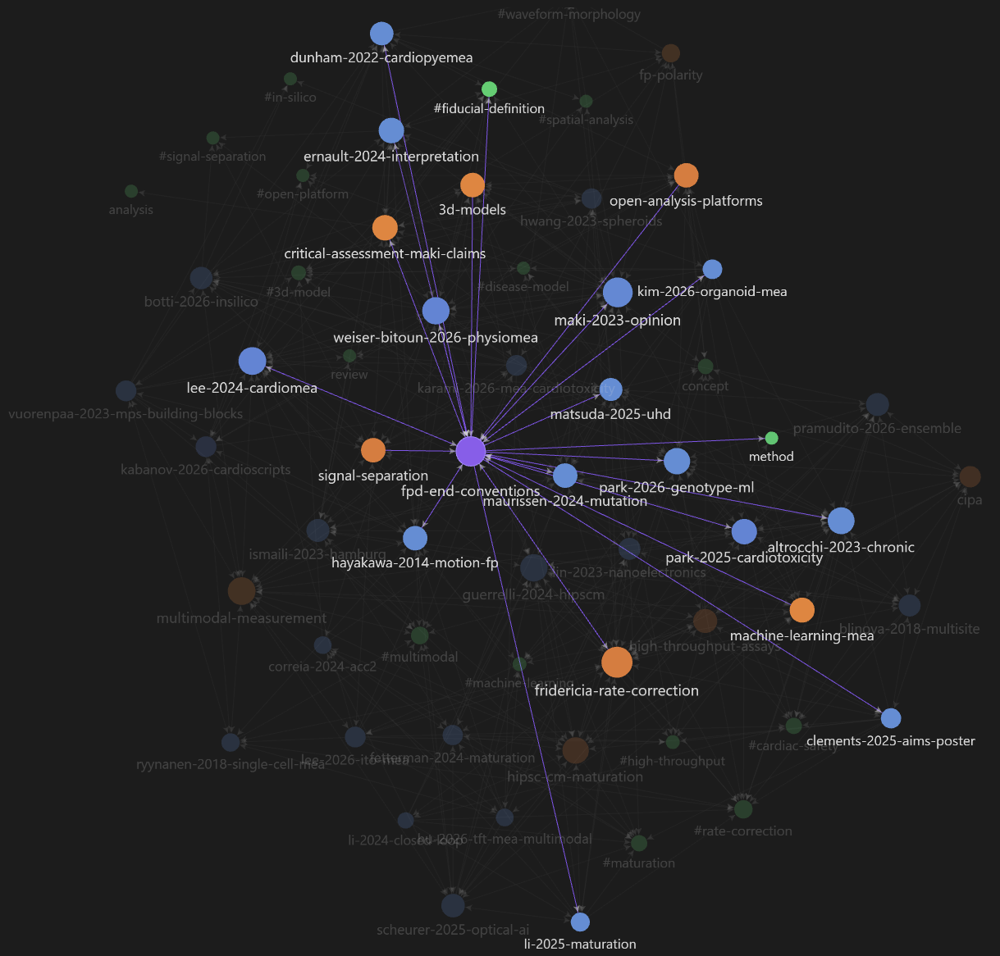

# Four Methodological Gaps in Field Potential Analysis of hiPSC-Cardiomyocytes: A Narrative Review of Multielectrode Array Studies Since 2022

A narrative review paper by Antti-Juhana Mäki, maintained with an LLM-assisted academic wiki workflow. The paper is in **[main.md](main.md)**. It is published as a preprint on Zenodo: **https://doi.org/10.5281/zenodo.24459573** (PDF, version 1, 2026-11-23). Release `v1.0` of this repository, its state at publication, is also archived on [Zenodo](https://doi.org/10.5281/zenodo.24459822 "10.5281/zenodo.24459822"); `main.md` may change after that.

## About this repository and AI assistance

This repository explores using AI agents as helpers in writing a review paper on MEA analysis of hiPSC-CMs since 2022. A second goal is to log the process (`wiki/log.md`) so that the workflow itself can be evaluated: how AI-assisted paper writing can be done efficiently, and where it goes wrong (for example, hallucinated citations caught during the work). The work was done mainly in VS Code with the Claude Code extension; [Obsidian](https://obsidian.md/) and [Foam](https://foambubble.github.io/foam/) were used and tested for reading the wiki and for viewing the links between its pages as a graph.

A blank template with the scripts, skills and conventions of this repository, for starting a paper of your own, is [llm-wiki-academic-template](https://github.com/AnaHill/llm-wiki-academic-template).

The author selects the sources, directs the agents and is responsible for the final text. The agents summarise sources, maintain the wiki and draft text. `scripts/check.py` checks that citations, the reference list and the wiki pages are consistent, but it cannot verify that a claim is true; that requires reading the source, and every claim in the paper is checked against its source before publication (see `docs/claims-by-source.md`). Not every intermediate commit has been reviewed in detail.

### The work that is easy to skip: keeping the wiki honest

The appeal of an LLM wiki is that it compounds. In Karpathy's description of the pattern:

> This is the key difference: the wiki is a persistent, compounding artifact. The cross-references are already there. The contradictions have already been flagged. The synthesis already reflects everything you've read. The wiki keeps getting richer with every source you add and every question you ask.

What is easy to miss is the sentence that makes that possible, a few lines further down:

> The LLM makes edits based on our conversation, and I browse the results in real time — following links, checking the graph view, reading the updated pages. Obsidian is the IDE; the LLM is the programmer; the wiki is the codebase.

*Browsing the results in real time* is the whole job. An unsupervised wiki does not stay empty, which would at least be obvious; it fills with plausible, well-formatted, confidently cross-referenced material that nobody has checked. It compounds either way. The reviewing is what decides which way.

This repository is a record of that work rather than an argument for it. What the reviewing caught here:

- **Invented sources.** Fabricated author lists for what became Dunham et al. (2022) and Hwang et al. (2023); an unverifiable Blinova 2025 entry, removed; and "Galli et al. 2024", a paper that does not exist, which reached the draft text and the reference list before it was found. The rule that every bibliographic detail is verified or flagged (`AGENTS.md`) was written because of these, not in anticipation of them.
- **Claims that outran their source.** Every claim the paper attributes to a source was read back against that source, one source at a time: over 200 claims across more than 30 sources (the counts are rounded here because they change with every ingest; the exact ones are in `docs/claims-by-source.md`, one checkbox per claim). Several did not survive unchanged. A statement that no study measured analysis-method variability became the narrower one that none compares two conventions on the same recordings. A tool described as built for 3D preparations turned out to rest on the word "organoid"; its source never calls the construct three-dimensional. A sentence saying "two of them" did not survive counting.
- **The author's own reasoning, separated from the sources.** Nearly forty statements in the paper are generalisations, reasoned steps or hypotheses that no single source supports. They are listed, each with where its warrant comes from, so that what the paper asserts on its own account is visible instead of blending into the cited material.

The division of labour that makes this sustainable is mechanical checks for what a script can decide and human reading for what it cannot. `check.py` knows that a citation has no reference entry, that a tag is outside the vocabulary, that a rendered figure is older than its diagram. It cannot know that a page summarises a study it misrepresents. Both halves are needed, and only one of them can be automated.

## How it works

| Layer | Path | Who owns it |
|-------|------|-------------|
| Source papers | `raw/` | PDFs and other source files (e.g. supplementary data). Immutable; only renamed at ingest. |
| Wiki pages | `wiki/` | LLM — paper summaries, concepts, gaps |
| Paper draft | `main.md` | LLM writes, author directs and edits |
| Own thinking | `notes.md` | Author only; the agent reads it, never edits it |



*The wiki in Obsidian's graph view (2026-11-23): paper pages in blue, concept and method pages in orange, tags in green. Highlighted is [fpd-end-conventions](wiki/fpd-end-conventions.md), the method page that sets side by side how each source defines the start and end of the field potential duration, the subject of one of the four gaps of the paper. Its links reach fourteen paper pages, six concept pages and two tags. The page adds no evidence of its own: it gathers what the paper pages record and backs Table 2 of the draft. A reference manager stores the sources; the wiki also stores how they relate.*

**Four operations (ask agent):**
- **Ingest** — drop a file (e.g. PDF) into `raw/`, LLM reads it, creates a summary page, updates the wiki, appends citation
- **Query** — ask anything; LLM reads the wiki and synthesizes an answer with citations
- **Draft** — ask to write or rewrite any section of `main.md`
- **Lint** — health check: stale claims, orphans, unsupported draft assertions; runs `scripts/check.py`

Before a non-trivial choice (what a section should claim, which sources to ingest or cite, which lint findings to fix), type `/grill-paper`: the agent interviews you in rounds, looks up the facts in the wiki itself and leaves the decisions to you.

To check the claims cited to one source, type `/grinding <source>` (for example `/grinding Hayakawa`): the agent reads the source in full and reports a verdict per claim in `docs/claims-by-source.md`, with the sentence from `main.md`, the supporting passage and its page, without changing anything. `/grinding wiki <source>` does the same one layer earlier, right after ingest: it checks the source's wiki page and every wiki sentence that cites it, so an error is caught before it is copied into concept pages and the paper; a page the author accepts gets a `**Checked against source:**` date, and `check.py` lists the pages without one.

[AGENTS.md](AGENTS.md) holds only what applies to every task (layout, hard rules, logging, the finishing check); the procedures are skills in [.claude/skills/](.claude/skills/): `ingest`, `draft` and `lint`, which Claude Code loads by their description when a task matches, and `grill-paper` and `grinding`, which run only when called. Other agents (Codex and the like) read AGENTS.md, whose table names the skill file to read for each task, so the repository does not depend on Claude Code. See [llm-wiki.md](llm-wiki.md) for the pattern.

### Agent design: a single loop with progressive disclosure

The repository follows the single-agent-loop design described in Anthropic's article [Building agents: when to fold subagents into your main agent loop](https://claude.com/resources/articles/building-agents-when-to-fold-subagents-into-your-main-agent-loop): one agent in one context window, instead of an orchestrator handing work to specialist subagents. The article's summary, "one clear system prompt, 4-5 thin data tools, and firm output guardrails would cover most of the use case", maps onto this repository as follows:

- **One clear system prompt:** [AGENTS.md](AGENTS.md), with a single owner (the author), kept short because it goes with every request.
- **Thin data tools:** seven scripts in `scripts/` (`check.py`, `claim_quotes.py`, `check_abbreviations.py`, `render_pdf_pages.py`, `figures.py`, `export.py`, `rotate_log.py`), plus `eval_skills.py`, which checks that each task still loads its skill, each doing one mechanical job and returning plain text the agent can read.
- **Progressive disclosure:** procedures that are needed only sometimes live in skills that load on demand: `ingest`, `draft` and `lint` (moved out of AGENTS.md on 2026-11-25, which cut it from 25 kB to about 6 kB), and `/grill-paper` and `/grinding`. The draft skill keeps the details of the claims file in a reference file of its own, read only when the claims file is edited.
- **Guardrails in the harness, not only in the prompt:** [.claude/settings.json](.claude/settings.json) denies file edits to `notes.md` and asks before any write to `raw/` (renames at ingest are approved one by one), and hooks ([scripts/hooks/harness.py](scripts/hooks/harness.py)) run the abbreviation and consistency checks after every edit of `main.md` and report whether the claims checklist is out of date with it; report a shell command that changed `notes.md` or a file in `raw/`, which the permission rules do not cover; and, when the agent is about to finish with uncommitted changes in the wiki or the paper, run the finishing check and keep it working on an error.
- **Rule plus mechanical check:** a rule in AGENTS.md alone gets forgotten, and a script alone cannot judge what makes a good tag or link. So each important convention has both: for example, the Draft operation tells the agent to write connections made in `main.md` back to the wiki, and `check.py` lists sources that `main.md` cites in one sentence but the wiki does not connect, and tags outside the agreed vocabulary.
- **Checking the output:** [docs/claims-by-source.md](docs/claims-by-source.md) lists every claim in `main.md` per source and is ticked off against the sources by hand, which serves as the evaluation set. Its last section registers the statements that are deliberately not sourced — generalisations, reasoned steps and the author's hypotheses — each with a **Support** value (`sourced`, `thin`, `inference`, `opinion`, `none`, `inherited`) saying where its warrant comes from, so that what the paper asserts on its own account is written down rather than left to the reader to spot.

---

## Repository layout

```
raw/               source documents (immutable; files are only renamed at ingest)
wiki/
  papers/          one page per ingested paper (firstauthor-year-keyword.md)
  index.md         content catalog — LLM reads this first on every query
  log.md           append-only operation log (older entries in log-archive/, see scripts/rotate_log.py)
  references.md    auto-maintained citation list (APA)
main.md            paper draft — IMRaD sections, single file (the two figures are ```mermaid blocks)
figures/           the diagrams copied out of main.md (.mmd, generated) and rendered for export (.svg)
main-export.md     build copy of main.md for the HTML and the PDF (generated by scripts/export.py, not in git)
notes.md           the author's own notes (the agent does not edit it)
docs/              process documents (see docs/README.md): claims-by-source checklist, lessons learned, AI reviewer brief, lint audit trail, PDF export notes, search strategy, maturation search record; images/ holds the images of this README
scripts/           check.py (consistency check), claim_quotes.py (main.md sentences under each source's claims; dry run by default, `--write` updates the file and puts ✅ on sources whose claims are all ticked), check_abbreviations.py (abbreviation list), render_pdf_pages.py (PDF text and page images), figures.py (diagrams to .mmd and .svg), export.py (build copy for HTML and PDF), rotate_log.py (log archives), eval_skills.py (does each task load its skill; headless Claude Code runs); hooks/harness.py holds the hooks
.claude/settings.json  permission rules (notes.md denied, raw/ asks) and the hooks
.claude/skills/    the procedures: ingest, draft, lint (loaded when a task matches), grill-paper and grinding (only when called)
AGENTS.md          wiki schema and LLM instructions (CLAUDE.md just imports it)
llm-wiki.md        the wiki pattern explained
```

---

## Licence

Unless noted otherwise, the written content of this repository (`main.md`, `wiki/`, `docs/` and `notes.md`) is released under the [Creative Commons Attribution 4.0 International licence (CC BY 4.0)](https://creativecommons.org/licenses/by/4.0/); the full text is in [LICENSE](LICENSE). This is the same licence that the Declarations of the paper give to the text. The code in `scripts/` is released under the MIT licence ([scripts/LICENSE](scripts/LICENSE)). `llm-wiki.md` comes from another author and keeps its own terms; `.claude/skills/grill-paper` is adapted from Matt Pocock's `grilling` skill and keeps its MIT licence; the other skills in `.claude/skills/` are written for this repository and released under the MIT licence, like the scripts. The source documents in `raw/` are not covered: they keep the licences and copyrights of their publishers and authors, and the non-open-access ones are kept out of the repository (see `.gitignore`).

## Tips

- **Select a section** in `main.md` and say *"rewrite this"* — agent edits only that section.
- **`[CITATION NEEDED]`** markers mean no supporting source was found — add the paper and re-ingest.
- **Graph view** in Foam or Obsidian shows how paper pages link across the wiki — useful for spotting coverage gaps. The settings behind the image above are in [docs/images/README.md](docs/images/README.md).
- **`wiki/references.md`** is copy-paste ready for submission; tell agent your citation style if not APA.
- **`python -I scripts/check.py`** is run after every change to the wiki or `main.md`; it reports broken links, missing references and unescaped hashes (a `#word` in prose becomes a tag in Obsidian, so write it as `\#word`).
- **`docs/claims-by-source.md`** lists every claim in `main.md` per source, for checking the paper against the sources.

---

*Based on [Andrej Karpathy's LLM wiki idea](https://gist.github.com/karpathy/442a6bf555914893e9891c11519de94f) — see [AnaHill/llm-wiki-academic-template](https://github.com/AnaHill/llm-wiki-academic-template) for a reusable blank template.*
