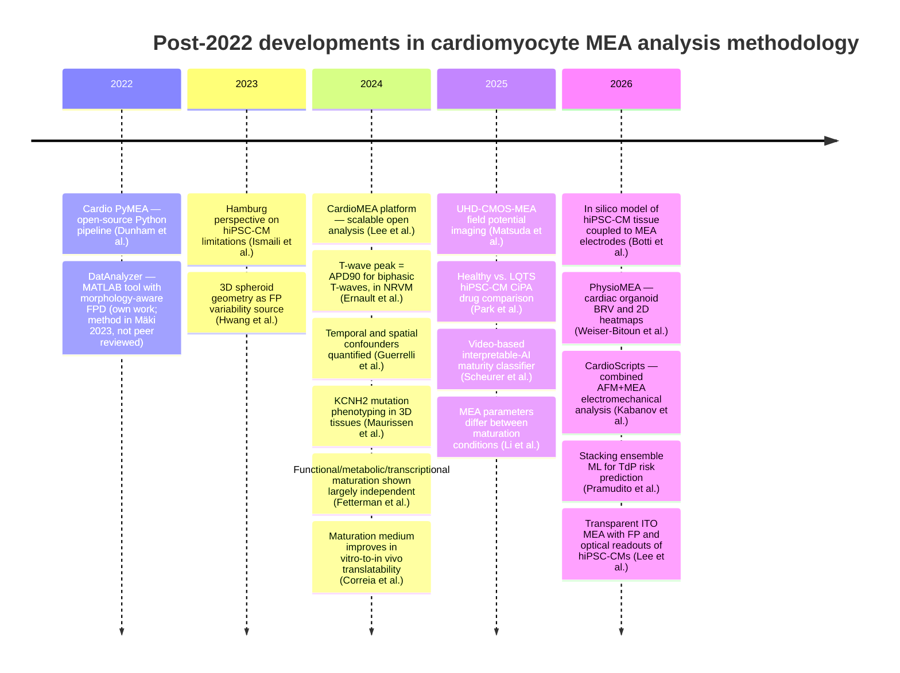
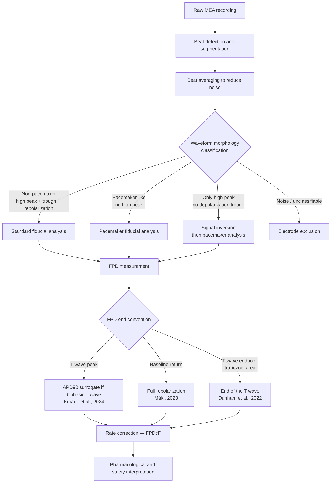

*Preprint, not peer reviewed. Prepared with AI assistance; see Declarations.*

# Abstract

Multielectrode array (MEA) recordings of extracellular field potentials (FPs) from human induced pluripotent stem cell–derived cardiomyocytes (hiPSC-CMs) are central to cardiac safety pharmacology, disease modelling, and proarrhythmia risk assessment. As the scope and complexity of these assays have expanded since 2022, the methods used to analyse FP signals have become a focus of attention as a possible source of inter-study variability. This non-systematic narrative review surveys a small selection of developments in cardiomyocyte MEA analysis methodology from 2022 to the present and compares them with the analysis practices recommended in the author's earlier opinion paper on FP signal analysis. In the studies examined, open analysis software is used alongside vendor software, and the open tools state how they place the waveform landmarks (fiducial points) that define the measured intervals; one study tested such a definition against intracellular recordings. Some tools adapt the analysis to the waveform shape, for example by inverting signals whose peaks point the other way. MEA analysis has also been applied to three-dimensional cardiac models. Assays have expanded to high-throughput and chronic use, with ultra-high-density electrode arrays and machine learning classifiers among the tools used. Despite these developments, **four methodological gaps remain** in the studies examined and are identified as priorities: (*i*) the absence of a validated hiPSC-CM–specific rate correction formula for field potential duration (FPD); (*ii*) the absence of shared and validated waveform morphology classification criteria; (*iii*) the need for dedicated validation of analytical frameworks in three-dimensional and spatially resolved MEA settings; and (*iv*) the absence of validated MEA-derived reference values for staging the electrophysiological axis of hiPSC-CM maturation status. Until these gaps are addressed, data-driven methods built on MEA parameters may learn differences in analysis methods rather than differences in the cells.

# Highlights

- MEA tools define FPD differently; their FPD values are not directly comparable
- No validated hiPSC-CM rate correction found; Fridericia can mislead at extreme rates
- No validated MEA-derived reference values for hiPSC-CM maturation were found
- Waveform morphology is handled case by case, without shared criteria
- Without these, machine learning may learn analysis differences rather than biology
- Raw MEA signals mix cell, tissue and device; separating them is proposed as a hypothesis

# Abbreviations

- **1D**, **2D**, **3D**: one-, two- and three-dimensional
- **AFM**: atomic force microscopy
- **AI**: artificial intelligence
- **AIMS**: Axion iPSC Model Standards
- **AP**: action potential
- **APD50**, **APD90**: action potential duration at 50% and 90% repolarization
- **BRV**: beat rate variability
- **CiPA**: Comprehensive in Vitro Proarrhythmia Assay
- **CMOS**: complementary metal-oxide-semiconductor
- **FP**: field potential
- **FPD**: field potential duration
- **FPDc**, **FPDcF**: rate-corrected FPD; FPD corrected with the Fridericia formula
- **hiPSC**: human induced pluripotent stem cell
- **hiPSC-CM**: human induced pluripotent stem cell–derived cardiomyocyte
- **ITO**: indium tin oxide
- **LAT**: local activation time
- **LQTS**: long QT syndrome
- **MEA**: multielectrode array
- **ML**: machine learning
- **NR**: not reported
- **NRVM**: neonatal rat ventricular myocytes
- **PRISMA**: Preferred Reporting Items for Systematic Reviews and Meta-Analyses
- **RR**: interval between successive beats (beat period)
- **TdP**: torsades de pointes
- **UHD**: ultra-high-density

# Introduction

Multielectrode arrays (MEAs) recording extracellular field potentials (FPs) from human induced pluripotent stem cell–derived cardiomyocytes (hiPSC-CMs) are widely used in cardiac safety pharmacology, drug discovery, and disease modelling (Blinova et al., 2018; Altrocchi et al., 2023; Park et al., 2025). The field potential duration (FPD) and related metrics serve as surrogates for repolarization and are integral to initiatives such as the Comprehensive in Vitro Proarrhythmia Assay (CiPA) (Blinova et al., 2018; Park et al., 2025). Reliable MEA recordings are considered essential for using hiPSC-CMs in drug development (Botti et al., 2026), and that reliability depends not only on the recording but also on consistent, physiologically meaningful analysis of FP waveforms. This review examines methods and analysis practices in cardiomyocyte MEA studies published since 2022, with an emphasis on open pipelines, fiducial definitions, morphology-aware handling, hiPSC-CM maturation status as an underexamined confound, and the implications of moving from two-dimensional to three-dimensional and high-throughput applications.

## Motivation: why analysis methods matter
In the studies examined, multielectrode array (MEA) recordings from human induced pluripotent stem cell–derived cardiomyocytes (hiPSC-CMs) are used not only for basic measurements such as beating rate and field potential duration (FPD), but also for mechanistic electrophysiological phenotyping (Maurissen et al., 2024; Park et al., 2025; Park et al., 2026), proarrhythmia risk assessment (Blinova et al., 2018; Pramudito et al., 2026), chronic drug testing (Altrocchi et al., 2023) and recordings repeated over days in culture (Guerrelli et al., 2024). This makes the analysis of the recorded signals important, and signal analysis methods, particularly the definition of fiducial points in field potential (FP) waveforms, are a plausible source of variability and a possible limit to inter-study comparability. The studies reviewed below show that conventions differ and that FPD does not always track the action potential, but none of them measures how much variability analysis methods cause, and a review of cardiac microphysiological systems describes the parametrization of action potentials and field potentials as well established and as enabling clear comparison of results between studies (Vuorenpää et al., 2023).

An opinion paper by the present author (Mäki, 2023) explicitly challenged the physiological validity of commonly used FP annotation conventions, arguing that the widely adopted peak-to-peak definition of FPD is often mismatched to the underlying electrophysiology of cardiomyocytes. In particular, it argues that the first positive FP peak in a propagating hiPSC-CM monolayer may reflect depolarization of neighboring cells rather than the locally recorded cardiomyocyte, and that FPD end should be measured to the return of the signal to baseline rather than the repolarization peak. Broader methodological and biological challenges of hiPSC-CMs as electrophysiological models—including ion channel expression, resting membrane potential, and the identity of cell subtypes—have been discussed from a critical perspective (Ismaili et al., 2023). This critique and these perspectives provide a useful conceptual framework for evaluating post-2022 developments in cardiomyocyte MEA analysis.

# Scope and Literature Search

This is a narrative review of methodological developments in cardiomyocyte MEA analysis from 2022 to the present. It does not follow a formal systematic review protocol (e.g., PRISMA) and does not report search statistics; rather, it synthesises a selection of developments with emphasis on analysis methodology. Candidate papers were identified iteratively with the help of artificial intelligence (AI) research assistants working from the terms like "*multielectrode array*", "*MEA*", "*hiPSC-CM*", "*field potential*", "*FPD*", "*signal analysis*", "*beat detection*", "*rate correction*", and "*cardiotoxicity*", with a primary temporal filter of 2022 to present and contextual coverage of earlier work where relevant, and were supplemented by following the reference lists of included papers and by suggestions from colleagues. A documented search of PubMed/MEDLINE (30 October 2026, no date limit), with citation chasing and web searches including bioRxiv, was used to check whether MEA-derived reference values for hiPSC-CM maturation had been proposed; its record is in the project repository (see Declarations). For the remaining selection, the databases queried, search dates, numbers of records screened, and explicit inclusion and exclusion criteria were not recorded. The selection should therefore be regarded as non-systematic, and the statements below refer to the studies examined rather than to the literature as a whole. Three-dimensional (3D) models and in silico modelling are broad fields that this review touches only where they bear on whether FP analysis methods transfer from two-dimensional (2D) monolayers. An opinion paper on FP signal analysis (Mäki, 2023), written by the present author, serves as an evaluative anchor: reviewed studies are assessed against the methodological standards and physiological reasoning it articulates. Because this paper is itself not peer reviewed, some of its claims are assessed critically below, and a competing-interest statement is given in the Declarations.

---

# Literature review

*Figure 1. Timeline of key methodological developments in cardiomyocyte MEA analysis, 2022–2026.*

## Open analysis pipelines alongside vendor-defined metrics
Among the studies examined, open and inspectable analysis pipelines specifically designed for cardiomyocyte electrophysiology are a visible alternative to vendor-provided "black-box" software. Such tools are not new, as MultiElec and CardioMDA, for example, existed before 2022 (Dunham et al., 2022; Lee et al., 2024), but several new ones have appeared since 2022, some of them built for new kinds of data such as high-density arrays (Lee et al., 2024) and cardiac organoids (Weiser-Bitoun et al., 2026).

Cardio PyMEA, introduced in 2022, is the earliest of the open pipelines published since 2022 that are examined here, and DatAnalyzer, the author's own tool described in Mäki (2023), was released the same year. This open-source Python-based application enables explicit analysis of cardiomyocyte MEA recordings, including beat detection, pacemaker origin estimation, beat interval and amplitude analysis, local activation time, upstroke velocity, and conduction velocity (Dunham et al., 2022). More recently, the CardioMEA platform (Lee et al., 2024) was built specifically for high-density MEA data: it extracts features from both extracellular and intracellular-like (electroporation-derived) signals, and includes an automated machine-learning module for ranking the features that separate diseased from control lines. PhysioMEA (Weiser-Bitoun et al., 2026) extended this trajectory with a platform whose software, source code and documentation are freely available, designed for cardiac organoids and providing one-dimensional biomarkers—FPD, spike amplitude, peak-to-peak duration, and inter-beat interval—across all recording electrodes, two-dimensional spatiotemporal heatmaps that quantify electrode-to-electrode variability in signal propagation, and beat rate variability (BRV) analysis with 45 standardised measures adapted from heart rate variability frameworks.

Together, these platforms point toward reproducibility, transparency, and explicit reporting of analysis parameters, enabling investigators to critically assess how electrophysiological features are derived rather than relying on opaque vendor defaults. The studies examined here do not show that this has displaced vendor software: the studies of Park et al. (2025) and Park et al. (2026), for example, analysed their recordings with the vendor's Cardiac Analysis Tool, and no usage data are available to estimate adoption of the open tools.

*Table 1. Open-source platforms for cardiomyocyte MEA analysis reviewed in this paper. FPD end convention refers to the definition used for the distal boundary of field potential duration. NR = not reported in the source reviewed. Year is the year of the describing publication; for DatAnalyzer it is the year of the first public release, the method being described in Mäki (2023).*

| Platform | Year | Language | FPD end definition | Distinctive features |
|---|---|---|---|---|
| Cardio PyMEA (Dunham et al., 2022) | 2022 | Python | T-wave endpoint (trapezoid-area algorithm) | Beat detection, LAT, conduction velocity, pacemaker origin estimation |
| DatAnalyzer (Mäki, 2023; author's own tool, not peer reviewed) | 2022 | MATLAB | Baseline return | Morphology-aware classification (3 waveform types); inversion for only-high-peak signals (not independently validated) |
| CardioMEA (Lee et al., 2024) | 2024 | Python | R-to-T-wave peak | High-density MEA; extracellular and intracellular-like signals; parallel processing, web dashboard; automated machine-learning feature ranking |
| PhysioMEA (Weiser-Bitoun et al., 2026) | 2026 | MATLAB | R-to-T-wave peak | 1D + 2D spatiotemporal heatmaps; beat rate variability (45 measures) |
| CardioScripts / Myopyth (Kabanov et al., 2026) | 2026 | Python | NR (T peaks detected) | Combined AFM + MEA; electromechanical coupling and decoupling analysis |

## Explicit and physiologically motivated fiducial definitions
In the studies examined, the open platforms state how they define fiducial points, and one study tested a convention against intracellular recordings. The opinion paper by Mäki (2023) describes a concrete, algorithmic approach: beat-aligned segmentation followed by averaging across multiple beats to reduce noise, threshold-based identification of depolarization onset relative to FP amplitude, and definition of FPD end as the return of the signal toward baseline rather than the repolarization peak.

The open platforms in Table 1 that measure FPD state their convention explicitly, and the conventions differ (CardioScripts reports QT and T-peak rather than FPD; Kabanov et al., 2026):

- **Cardio PyMEA**: from the R peak to a T-wave endpoint located with a trapezoid-area algorithm (Dunham et al., 2022)
- **CardioMEA** (Lee et al., 2024) and **PhysioMEA** (Weiser-Bitoun et al., 2026): from the R peak to the T-wave peak
- **DatAnalyzer**: from depolarization onset to baseline return (Mäki, 2023)

Such transparency is essential because differences in fiducial definitions can influence measured drug effects and rate-corrected FPD or QT surrogates. Ernault et al. (2024) demonstrated using simultaneous MEA and sharp-microelectrode recordings from neonatal rat ventricular myocyte (NRVM) monolayers that the peak time of the T wave in FPs correlates strongly with the action potential duration at 90% repolarization (APD90), but only when the T wave displays a biphasic pattern — a morphology the authors report in only a minority of recorded monolayers. This anchors the T-wave peak, when the waveform is biphasic, to APD90. The baseline-return convention was not compared with the action potential in that study, and in monolayers with only a positive T wave the T wave ended before the end of the action potential (Ernault et al., 2024); the two definitions may therefore measure different quantities rather than one being universally more correct. Direct evidence from hiPSC-CMs points in the same cautious direction: in high-density recordings from iCell cardiomyocytes, R-to-T-peak FPD correlated only minimally with the action potential duration at 50% repolarization (APD50) and APD90 measured from intracellular-like signals on the same electrodes, which the authors attribute to small, noisy T waves (Lee et al., 2024). Earlier work with simultaneous video and MEA recordings in iCell monolayers likewise noted that the two FPD end points in use at the time, the peak of the positive deflection and the return of the positive deflection to baseline, appeared to correspond to different phases of the relaxation motion (its upstroke and its peak, respectively), and that an accurate end point was difficult to establish (Hayakawa et al., 2014). These findings underscore the importance of waveform morphology assessment prior to any fiducial-point-based analysis. The robustness of the baseline-return convention has not been examined in the studies reviewed here: Mäki (2023) averages beats to reduce noise, but how the end point behaves at low signal-to-noise ratios or with baseline drift is not evaluated.

*Table 2. Field potential duration (FPD) fiducial definition conventions observed in the reviewed literature. APD50/APD90 = action potential duration to 50%/90% repolarization; NRVM = neonatal rat ventricular myocytes. The baseline-return convention has not been compared with the action potential in the studies reviewed, so whether it and the T-wave-peak convention measure different physiological quantities is open.*

| Convention | FPD start | FPD end | Relation to the action potential in the studies reviewed | Studies |
|---|---|---|---|---|
| R-to-T-peak | R peak (Hayakawa et al., 2014: initial negative peak) | T-wave peak | T-wave peak coincided with APD90 only for biphasic T waves (a minority morphology; NRVM, not hiPSC-CM; Ernault et al., 2024); in hiPSC-CMs, R-to-T-peak FPD correlated only minimally with APD50 and APD90 (Lee et al., 2024); the peak of the positive deflection appeared to match the upstroke of relaxation (Hayakawa et al., 2014) | Hayakawa et al., 2014; Lee et al., 2024; Weiser-Bitoun et al., 2026; described as a common convention and criticised in Mäki, 2023 |
| Baseline return | Depolarization onset (10% threshold) | Signal return to within 10% of baseline | Intended to capture the full repolarization wave (Mäki, 2023); not compared with the AP; return to baseline appeared to match the peak of relaxation (Hayakawa et al., 2014) | Mäki, 2023 |
| T-wave endpoint (trapezoid area) | R peak | T-wave end located with a trapezoid-area algorithm | Not validated against the AP in the source | Dunham et al., 2022 |

## Rate correction of field potential duration (FPDc)
A methodologically critical step in cardiomyocyte MEA analysis is the correction of FPD for spontaneous beating rate. Since hiPSC-CM cultures beat spontaneously at variable rates, the beating rate can change substantially during recordings. Therefore, raw FPD values are confounded by rate-dependent repolarization effects. By analogy with the clinical QT interval, the Fridericia formula ($FPDcF = FPD/RR^{0.33}$, where RR is the interval between beats) is the correction used in the studies examined here that report rate-corrected FPD (Altrocchi et al., 2023; Hwang et al., 2023; Maurissen et al., 2024; Park et al., 2026); Park et al. (2025) also report corrected FPD but do not name the formula. Fridericia correction was already in use before 2022: the blinded multisite CiPA study (ten sites, 28 reference drugs) applied it to all its FPD data, although its authors noted that the formula had not been thoroughly validated for hiPSC-CMs (Blinova et al., 2018). A recent proposed acceptance standard for hiPSC-ventricular-CM MEA assays likewise builds the Fridericia correction into quality control, by requiring a rate-corrected FPD (FPDc) of 200–700 ms (Clements et al., 2025). An exception is the pre-2022 single-cell study of Ryynänen et al. (2018), which corrected FPD with Bazett's formula.

However, the application of clinical rate-correction formulas to in vitro hiPSC-CM preparations has unresolved limitations. Beating rate and FPD change during the first minutes of a recording, and an equilibration period of 15–20 min is recommended before baseline recordings (Guerrelli et al., 2024; see also the section on high-throughput and long-term assays). Furthermore, a fixed cube-root correction cannot be assumed to hold across the wide range of spontaneous rates of hiPSC-CMs, which are accepted at 20–90 bpm in the multisite CiPA study (Blinova et al., 2018) and 20–80 bpm in a proposed acceptance standard (Clements et al., 2025), so the formula may under- or over-correct at the extremes of this range. In one hiPSC-CM study, doxorubicin slowed the beat period to about 8 s, and Fridericia-corrected FPD then fell while uncorrected FPD rose (Lee et al., 2026). In the author's view, the lack of a validated hiPSC-CM–specific formula is a methodological gap that directly limits the comparability of FPDc endpoints between studies. Pacing at a fixed rate removes the rate dependence, and Guerrelli et al. (2024) repeated their measurements under 1.5 Hz pacing for this reason. Matsuda et al. (2025), however, recorded spontaneous beating only and name the absence of pacing as a limitation, and the proposed acceptance standard is defined for spontaneously beating cells: more mature cells can beat with periods longer than its 3000 ms upper limit, which makes recordings impractically long, so pacing would probably be needed, a paced assay being left to a possible future standard (Clements et al., 2025).

FPDc change (ΔFPDc) is nevertheless used as one of the input features of machine-learning classifiers of proarrhythmic risk in two of the studies examined. A stacking ensemble of several classifiers outperformed each of its constituent classifiers in predicting torsades de pointes (TdP) risk on 16 held-out CiPA reference compounds (Pramudito et al., 2026), and a patient-line study trained machine-learning classifiers on Fridericia-corrected FPDc and other MEA parameters from long QT and Brugada syndrome lines (Park et al., 2026). The latter shares its group, platform and apparently a long QT line with Park et al. (2025), so the two are better read as one body of evidence than as independent replication, and its two Brugada lines consisted largely of atrial-like cells, so their comparison with ventricular-like normal lines is confounded by cell identity. Both machine-learning studies took the rate correction as given: Pramudito et al. (2026) used ΔFPDc values already corrected in the multisite CiPA dataset, and neither tested how the choice of correction affects classifier performance. Both evaluated their models on small test sets of 15–16 drugs by repeated resampling.

## Maturation status as an unresolved confound for MEA-derived metrics
Maturation adds a further complication for comparisons between studies, distinct from but interacting with rate correction. hiPSC-CMs are electrophysiologically immature compared with adult cardiomyocytes and retain a fetal-like phenotype (Correia et al., 2024; Scheurer et al., 2025). They express ion channels that are absent from adult working myocardium, notably the funny current (If) and occasionally the T-type Ca²⁺ current, although the latter is not necessarily a sign of immaturity (Ismaili et al., 2023). Whether ventricular-, atrial- and nodal-like cells form distinct subpopulations within one preparation is debated (Ismaili et al., 2023), but patch-clamp data show such subtypes in the lines of Park et al. (2026).

In the studies examined, maturation state is rarely quantified beyond culture duration. Because FPD, its rate correction and waveform morphology are all measured on such cells, two laboratories could report different results for the same compound because their cultures differ in maturity rather than in analysis method. Guerrelli et al. (2024) show this kind of drift in an MEA setting: over days 2–14 in culture, FPD lengthened by about 257 ms and the beating rate declined, while *KCNJ2* (IK1-encoding) expression rose 27.5-fold over 30 days, changes the authors link to continued maturation. FPD also lengthened when the cells were paced at a fixed 1.5 Hz (from 275.5 ms on day 3 to 336.0 ms on day 14), so the drift is not only a consequence of the slower beating rate, and rate correction alone would not remove it.

A recent high-throughput study outside the MEA literature limits what such a reference value could measure: when the components of a maturation medium were added or removed one at a time, functional (electrophysiology and excitation–contraction coupling), metabolic and transcriptional maturation responded largely independently (Fetterman et al., 2024). Maturation is therefore not a single quantity. An MEA-derived reference value can only observe electrophysiology, so it would describe one axis of maturity, not the overall maturation status of a preparation.

No study proposing or validating MEA-derived reference values for hiPSC-CM maturation was found in a search of PubMed/MEDLINE (30 October 2026, no date limit), supplemented by citation chasing and web searches including bioRxiv (see Scope). Individual MEA parameters do differ between maturation conditions. In Li et al. (2025), conduction velocity and spike amplitude rose from a standard B27 medium to a fatty-acid-enriched maturation medium, and further with nanopatterning and electrostimulation. Patch-clamp markers measured in other cells of the same groups changed in the same direction, but the authors do not propose these values as maturity markers. An industry-led proposal also exists, the Axion iPSC Model Standards (AIMS) \#CM01 of Axion BioSystems (Clements et al., 2025), presented as a poster at the 2025 meeting of the International Society for Stem Cell Research. It defines minimum acceptance criteria for MEA wells of spontaneously beating hiPSC-ventricular cardiomyocytes (spike amplitude, synchronised beating, beat period and FPDc). These criteria target assay quality control, not maturation staging, and the proposal has not been published as a peer-reviewed methods paper. Whether a culture meets the amplitude criterion also depends on when it is recorded: in Guerrelli et al. (2024), the mean spike amplitude of spontaneously beating cells of two commercial lines was below 0.5 mV two days post-defrost and had risen to several millivolts by day 14, whereas the proposal leaves culture protocols to the cell vendors (Clements et al., 2025).

Two further studies sharpen this picture without closing the gap. Correia et al. (2024) developed a maturation medium that improved electrophysiological, metabolic and structural maturation, and for one drug target, in vitro results correlated with in vivo results only in matured cells.

Scheurer et al. (2025) showed that an interpretable machine-learning classifier can separate immature (day 21) from more mature (day 42, maturation medium) hiPSC-CM cultures with 99.5% accuracy on a hold-out test set of 46 videos. It uses only non-invasive, video-based beating features. Scheurer et al. also cite earlier evidence linking field potential duration to contraction duration; in that work, the two were linearly related across drug concentrations under non-arrhythmic conditions, with a different slope for each drug (Hayakawa et al., 2014).

Taken together, some ingredients of an MEA-based maturity classifier have been reported separately: an interpretable machine-learning method validated on video features (Scheurer et al., 2025), MEA parameters that differ between the same maturation conditions (Li et al., 2025, whose B27 and maturation-medium groups Scheurer et al. follow), a reported link between FPD and contraction (Hayakawa et al., 2014), and evidence that maturation status matters for translation (Correia et al., 2024). The missing ingredient is an independent maturity measure taken on the same MEA cultures. The closest step towards combining them is Lin et al. (2023), who ordered extracellular waveforms along an electrical-maturation trajectory by unsupervised machine learning (pseudotime). Their recordings came from stretchable electrodes embedded in 3D microtissues, not from MEA plates, their features describe only the depolarization spike and not FPD, and no external maturity measure was taken on the same cultures. No classifier or reference value for standard MEA recordings, validated against an independent maturity measure on the same cultures, has been reported.

## Morphology-aware analysis and handling of heterogeneous FP waveforms
FP waveform morphology varies between preparations and over culture time, and some of the studies examined adapt their analysis to it, for example by detecting peaks on the inverted signal. Pacemaker-like signals lacking a pronounced high peak, waveforms dominated by a single peak, and mixed or atypical morphologies are described in hiPSC-CM cultures (Mäki, 2023), and hiPSC-CM preparations contain nodal-like cells (Park et al., 2026).

The opinion paper (Mäki, 2023) explicitly addresses these cases by proposing morphology-aware handling strategies, including specialized interpretation of pacemaker-like signals and pragmatic preprocessing — such as waveform inversion for "only high peak" cases, an approach internally validated in that work but not yet independently replicated — prior to standard analysis.

*Figure 2. Schematic of a morphology-aware field potential analysis pipeline. Waveform classification determines the analysis branch applied before FPD measurement; rate correction is applied after. The signal-inversion branch is the author's own proposal (Mäki, 2023) and has not been independently validated.*

The studies examined do not adopt identical rules, but two of them show an awareness of waveform heterogeneity: they report morphology-dependent analysis branches or document that T-wave morphology varies between preparations, which indicates that a single canonical FP shape cannot be assumed (Ernault et al., 2024; Weiser-Bitoun et al., 2026). Such variation is not new: the opinion paper summarises large differences in FP signal forms and repolarization phases and cites earlier work explaining them by where the activity arises relative to the electrode and by overlapping signals in later cultures (Mäki, 2023). Nonetheless, fiducial definitions remain inconsistent across open platforms: PhysioMEA, for instance, defines FPD as the interval from the R-peak to the T-wave peak (Weiser-Bitoun et al., 2026) rather than the return to baseline (Mäki, 2023), and FPD values are therefore not directly comparable across tools without explicit knowledge of the underlying convention.

The polarity of the recorded signal is a further assumption that is rarely stated. Cardio PyMEA detects beats at the most prominent peak of the field potential and places local activation at the steepest negative deflection after it (Dunham et al., 2022), so its analysis presupposes the polarity of its recordings, which the paper does not state. Which sign the repolarization wave should have cannot simply be assumed either, because depending on cell–electrode coupling the FP may follow the membrane potential or its first or second time derivative (Karami et al., 2026). The shape of the T wave can also decide which signal is analysed: Guerrelli et al. (2024) chose for FPD analysis an electrode whose T wave was upright or had a positive portion of a biphasic T wave.

## Three-dimensional cardiomyocyte models
3D models include spheroids, organoids and engineered tissue sheets. The opinion paper cautions that analysis frameworks optimised for 2D monolayers may not transfer to them directly (Mäki, 2023), and the studies examined give partial answers. In simulations of hiPSC-CM spheroids on MEAs, compared with in vitro recordings, field potential shapes varied strongly with the stimulation and electrode locations even with a single cell type, so the 3D geometry itself adds FP variability (Hwang et al., 2023); this evidence comes from a simulation with one cell source and two drugs. Maurissen et al. (2024) recorded gene-edited *KCNH2* lines (N588D, long QT; N588K, short QT) both as 2D monolayers and as 3D cardiac tissue sheets on MEAs. Fridericia-corrected FPD was close in the two formats for all three genotypes, so this endpoint transferred in that setting. TdP-like and ventricular tachycardia–like waveforms with E-4031 were reported in the 3D sheets, which the authors, citing their earlier work, consider necessary for inducing them; the same conditions were not tested in 2D, and the cardiomyocyte purity of the sheets was 25–41%. The recording itself may also be limited: the authors of a study with tissue-embedded electrodes argue that conventional MEAs contact a 3D microtissue only at one surface and lose contact as the tissue contracts (Lin et al., 2023). Analysis tools are beginning to target 3D preparations, such as PhysioMEA for cardiac organoids (Weiser-Bitoun et al., 2026), but no study examined here compared fiducial definitions between 2D and 3D recordings systematically.

## High-throughput and long-term assays
Several of the studies examined addressed high-throughput and chronic applications, particularly in cardiotoxicity and proarrhythmia screening. These applications require stable beat detection, robust handling of arrhythmic events, and consistent analysis across extended recording periods and large historical datasets.

A chronic MEA assay with repeated recordings over four days has been validated for both acute and delayed cardiotoxicity (Altrocchi et al., 2023). The authors recorded acute (<2 h) and delayed (≥24 h) electrophysiological and cytotoxic effects of reference compounds, combining field potentials with impedance, on a platform they describe as medium-throughput. Vehicle-treated wells also drifted over the four days: by 96 h, mean beating rate had fallen by 5.8% and mean FPDc had risen by 7.9% despite Fridericia correction (Altrocchi et al., 2023, Table 2). The authors therefore judged compound effects against tolerance intervals computed from vehicle wells at each time point. Disease-line screening is another application: Park et al. (2025) compared eight arrhythmia-inducing drugs on healthy and long QT syndrome–derived hiPSC-CM lines, and the same group later tested 28 compounds on patient-derived long QT and Brugada syndrome lines (Park et al., 2026). Both reported disease-specific drug sensitivities.

In the studies examined, single conventional metrics are complemented by multi-parameter feature sets: beat rate, beat-to-beat variability, conduction properties and event-based descriptors (Altrocchi et al., 2023; Matsuda et al., 2025). This makes clearly defined analysis methods even more important. Temporal drift and culture equilibration effects can confound interpretation if fiducial definitions and quality control criteria are not reported. Guerrelli et al. (2024) quantified these effects directly. Over a 20-minute equilibration window, beating rate increased by 22.6% and FPD decreased by 7.7%, and over 2–14 days in culture the beating rate fell while FPD lengthened (see the maturation section). The authors recommend standardised protocols and reporting of key conditions such as culture time and equilibration time, but the analysis parameters in their example reporting datasheet are limited to the number of electrodes analysed and the averaging time, with no field for the FPD definition or rate correction (Guerrelli et al., 2024).

Hardware advances have broadened the feature set further. Ultra-high-density complementary metal-oxide-semiconductor (CMOS) MEA platforms with close to a quarter million electrodes give spatially resolved excitation origin counts, propagation area and conduction velocity maps, in addition to conventional endpoints such as beat rate and inter-beat interval (Matsuda et al., 2025). With this platform, doxorubicin-induced cardiotoxicity was detected at 0.03 µM within 24 h, a concentration 10-fold lower than reported in earlier studies.

---

# Discussion and future outlook

The developments above concern how FP signals are annotated, corrected and interpreted. Two directions that go beyond them are outlined here. Both are prospective views of the present author, build on the author's opinion paper (Mäki, 2023; see the references therein) and are not results of the studies reviewed; they should be read as hypotheses, not as findings.

**Multimodal recordings and AI-assisted sensor fusion.** Several of the studies examined already add a second measurement to the MEA recording: impedance read alongside FP (Altrocchi et al., 2023), intracellular-like signals obtained through the same electrodes by electroporation (Lee et al., 2024), and contraction force from simultaneous atomic force microscopy (Kabanov et al., 2026), whose synchronous validation was done on embryoid bodies only. Earlier work recorded image-based motion and MEA field potentials simultaneously in hiPSC-CM monolayers and found linear relationships between contraction–relaxation duration and FPD across drug concentrations, with drug-specific slopes (Hayakawa et al., 2014). Video-based beating features have also been classified with an interpretable machine-learning model, although without MEA data (Scheurer et al., 2025), and an MEA with transparent electrodes has been used to record the field potential and the video-based motion of the same single human pluripotent stem cell–derived cardiomyocyte at the same time, although the two recordings were not automatically synchronised (Ryynänen et al., 2018). A transparent indium tin oxide (ITO) MEA has also been used to record field potentials, morphology and Ca²⁺ imaging of hiPSC-CMs in the same wells, with the readouts reported side by side (Lee et al., 2026). A recent proof of concept on a transparent thin-film-transistor MEA recorded field potentials and video of the same culture of fetal mouse cardiomyocytes and analysed both with interpretable machine learning, separating the recording before and after isoprenaline (Hu et al., 2026). It used ten electrodes and depolarization-based features without FPD, and the two modalities were clustered separately, so how far they were combined in one model is unclear.

In most of these studies the modalities are analysed separately or side by side, and the one joint analysis is a small proof of concept outside hiPSC-CMs. The hypothesis here is that interpreting them jointly (sensor fusion), with AI support, could give a more complete picture of a preparation than any single signal, for example by adding MEA-derived parameters to a video-based classifier of maturation status, for which MEA data from the same maturation conditions already exist (Li et al., 2025). A review of cardiac microphysiological systems likewise sees potential in combining different measurement modalities, which heart-on-chip systems can monitor concurrently (Vuorenpää et al., 2023).

The proposal is not to feed raw MEA signals to a model, which the author has doubted would work given how much FP amplitude, frequency and shape differ between cultures (Mäki, 2023). Instead, several of the parameters discussed in this review (for example FPD, amplitude and beat interval) would be extracted from detected peaks and combined with parameters from the other measurements as inputs to machine-learning models, which is the two-step approach of the opinion paper. The peak-detection step may be a challenge if real-time analysis is wanted. A further caution is that machine-learning classifiers in the studies examined were trained on small datasets (Scheurer et al., 2025; Park et al., 2026; Pramudito et al., 2026). The doubt concerns the raw recording as it is, shaped by the culture and the recording system. If the cellular signal could be separated from it, as outlined next, that signal could be a useful input in its own right, beyond the parameters extracted from it; whole extracellular waveforms have already been used as machine-learning input, in tissue-embedded recordings (Lin et al., 2023).

**Separating the recording system from the cellular signal.** An FP is the cellular signal as shaped by the surrounding tissue and by the recording hardware, including electrode geometry, cell–electrode coupling, cell density and gap-junctional coupling (Karami et al., 2026), and several of the studies examined show that FP features do not map directly onto the action potential (AP). The T-wave peak tracks APD90 only when the T wave is biphasic (Ernault et al., 2024), and R-to-T-peak FPD correlated only minimally with APD50 and APD90 from intracellular-like signals on the same electrodes (Lee et al., 2024). Forward modelling already includes the electrode: a bidomain model with a resistor–capacitor electrode model simulates FPs from phenotype-specific cell models (Botti et al., 2026). The cell–electrode interface can be described by an equivalent circuit in which the recorded voltage depends on the membrane potential through the seal resistance and the impedances of the junctional membrane, the electrode and the amplifier; depending on how tightly the cells adhere, the signal follows the membrane potential or its first or second time derivative (Karami et al., 2026). This is the kind of device model that the inverse approach would have to estimate.

The hypothesis is the inverse direction: working backwards from the measured signal. The contribution of the MEA device, and as far as possible of the tissue, could be estimated by reverse engineering, for example with system identification, and then separated from the signal. The remaining signal would resemble the cellular AP more closely. It would then measure cell-level changes and drug responses more directly (Mäki, 2023; see the references therein). Electroporation through the recording electrodes (Lee et al., 2024) yields paired FP and AP-like signals from the same electrodes and is therefore a candidate source of training and validation data, and AI-assisted sensor fusion of further simultaneous modalities could add ground truth.

The recording-side contribution may also change during an experiment. In the chronic assay of Altrocchi et al. (2023), a background impedance signal was recorded alongside the FP; the authors describe a drop in impedance when the cells attach less well to the bottom of the well, owing to cell death or changes in the monolayer morphology, and used it as a readout of cytotoxicity to help separate electrophysiological effects from cell death. The hypothesis here is that such an impedance channel could also indicate FP changes that stem from altered attachment, and thus from altered coupling between cells and electrodes, rather than from changes in the AP of the cells themselves. Impedance is sensitive to the distance between cells and electrode, down to changes of about 1 nm (Karami et al., 2026), so it could in principle register changes in coupling. Whether FP features change measurably with attachment alone was not tested in that study.

Whether the AP can be recovered from the FP at all is an open question. Removing the device contribution alone would not be sufficient, because a field potential is a weighted sum of the transmembrane currents of many surrounding cells, which may also make the recovery an ill-posed inverse problem (Karami et al., 2026). The paired signals proposed above as training data share part of this limitation: a local extracellular action potential obtained by electroporation is not a recording of the local AP but is generated by current from neighbouring cardiomyocytes (Ernault et al., 2024).

A calibrated model of the cells, tissue and device, with parameters fitted to the measured signals, could be called a digital twin of the recording. The forward model of Botti et al. (2026) is the closest existing component among the studies examined, but it was not fitted to new measurements. The review of cardiac microphysiological systems cited above notes that continuous, multimodal measurements give a holistic data set for parameterising and validating computational models and that, to its authors' knowledge, integrative simulations of all building blocks of a microphysiological system had not been published (Vuorenpää et al., 2023). If the separation worked, it would also make FP-derived results from different hardware more comparable, since chip composition and recording hardware can alter absolute signal values (Lee et al., 2026), and the separated cellular signal could serve as the machine-learning input discussed above, rather than only the parameters extracted from the raw recording.

---

# Limitations of this review

This review has the following limitations:

- (i) The selection of studies is non-systematic. It was assembled with AI assistance and by citation tracing, with one documented search on maturation reference values (see Scope). It is therefore neither exhaustive nor reproducible as a search, and it may over-represent particular groups and journals.
- (ii) The evidence base is small and uneven. Most methodological statements rest on one or two studies, and some rest on rat cells (Ernault et al., 2024), fetal mouse cells (Hu et al., 2026), simulations (Hwang et al., 2023; Botti et al., 2026), tissue-embedded electrodes (Lin et al., 2023) or modalities other than field potentials (Fetterman et al., 2024; Scheurer et al., 2025). No usage or prevalence data were collected, so statements about trends in practice, such as the adoption of open tools, are illustrative only.
- (iii) The review was written by a single author, without independent screening, data extraction or risk-of-bias assessment.
- (iv) The evaluative framework is the author's own opinion paper (Mäki, 2023), which is not peer reviewed. Some of its claims, such as waveform inversion for "only high peak" signals, have not been independently replicated, and its FPD-end convention is only one of several in use (Table 2).
- (v) Full texts were consulted wherever available, but figures were not inspected for all of them, and supplementary files such as videos and raw tables were generally not examined.
- (vi) A few works from before 2022, such as Blinova et al. (2018), Hayakawa et al. (2014) and Ryynänen et al. (2018), are cited only as background for conventions, datasets and earlier multimodal work. They are not among the post-2022 developments reviewed.
- (vii) The Discussion and future outlook section is speculative. It states hypotheses of the author, builds on the author's own opinion paper (Mäki, 2023), and none of its proposals was tested in the studies examined.

---

# Conclusion

In the studies examined here, open analysis platforms that state their fiducial definitions are used alongside vendor software, one fiducial convention has been tested against intracellular recordings, and some tools adapt their analysis to the waveform shape. These are preconditions for comparing results between studies, but whether they have improved comparability cannot be judged from this small evidence base, and vendor software remains in use in several of the studies reviewed.

Four methodological gaps stand out as priorities:

1. **No validated FPD rate correction for hiPSC-CMs was found.** The Fridericia formula, borrowed from clinical electrocardiography, lacks formal validation for the beating rate range and rate–FPD relationship of hiPSC-CM cultures. A cell-type–specific correction formula, ideally derived from large multi-laboratory datasets, would make FPDc a more reliable pharmacological endpoint.
2. **Shared, validated waveform morphology classification criteria were not identified.** In the studies examined, morphology handling is described case by case: analysis of inverted signals, exclusion of electrodes, or interpretation restricted to biphasic T waves (Mäki, 2023; Ernault et al., 2024; Weiser-Bitoun et al., 2026). In contrast, quantitative criteria exist for well acceptance, such as amplitude, rate and beat period (Blinova et al., 2018; Clements et al., 2025). Standardised morphology assessment along the same lines might reduce between-study variability at the data collection stage.
3. **The transfer of 2D-calibrated analysis frameworks to 3D models and ultra-high-density platforms proceeds empirically.** Fiducial definitions and conduction metrics need dedicated validation in 3D cardiac tissues and spatially resolved MEA recordings before these endpoints can be used with confidence in pharmacology. In one study, Fridericia-corrected FPD was similar in 2D monolayers and 3D tissue sheets (Maurissen et al., 2024), but in simulations the 3D geometry alone changed FP shape (Hwang et al., 2023), and conventional MEAs contact 3D tissue only on one surface (Lin et al., 2023).
4. **hiPSC-CM maturation status lacks MEA-derived reference values.** No validated benchmark allows a laboratory to report how mature its preparation was at the time of recording. Because functional, metabolic and transcriptional maturation are induced largely independently (Fetterman et al., 2024), such a benchmark could only cover the electrophysiological axis. Even a partial reference would improve comparability between studies and support the translation of MEA findings to adult myocardium; for one drug target, in vitro results correlated with in vivo results only in matured cells (Correia et al., 2024). Some ingredients for such a reference have been reported separately: an interpretable machine-learning approach validated on non-invasive beating features (Scheurer et al., 2025), MEA parameters that differ between maturation conditions (Li et al., 2025) and a reported link between field potential duration and contraction duration (Hayakawa et al., 2014); what is missing is an independent maturity measure taken on the same MEA cultures. Unsupervised tracking of electrical maturation from extracellular waveforms has been shown with tissue-embedded electrodes in 3D microtissues (Lin et al., 2023), but no classifier or reference values have been reported for standard MEA recordings.

Looking forward, machine learning is used in several of the studies examined — from ensemble classifiers for TdP risk prediction (Pramudito et al., 2026) and genotype-specific risk models (Park et al., 2026) to automated feature ranking in an open platform (Lee et al., 2024) — and it may become a more integral layer of cardiomyocyte MEA workflows. Two further directions, AI-assisted fusion of MEA with other measurements and the separation of the recording system from the cellular signal, are outlined as hypotheses in the Discussion and future outlook section. Open analysis software and explicitly reported fiducial definitions are a precondition for this: without them, models built on MEA parameters may reproduce the inconsistencies between studies instead of revealing biological effects.

---

# Declarations

**Status.** This is a preprint and has not been peer reviewed.

**Competing interests.** The author wrote the opinion paper used here as the evaluative framework (Mäki, 2023) and the *DatAnalyzer* tool listed in Table 1, and therefore has an interest in how they are assessed. Several authors of the review Vuorenpää et al. (2023) and of Ryynänen et al. (2018), both cited in this review, are colleagues of the author from the Centre of Excellence in Body-on-Chip Research ([CoEBoC](https://research.tuni.fi/coeboc/)) research collaboration at Tampere University; the author is not an author of either. No other competing interests are declared.

**Version note.** "Mäki (2023)" refers to the opinion paper whose first version was posted on Zenodo in 2023; the text assessed here is version v3 of the same record, published on 23 June 2026, which slightly updated the original text (mainly outlook).

**Use of AI assistance.** Large language model agents (Anthropic's Claude, used through the Claude Code tool; Cursor in very early versions) assisted with literature searching and screening, summarising sources into a structured set of notes, checking citations and drafting and editing this text. The author selected the sources, directed and reviewed the work, and is responsible for the content. Every claim that the text attributes to a source is listed in a checklist for verification against that source, and statements that are the author's own inferences are listed separately; both lists are in the project repository. Bibliographic details were checked against the source documents or publisher records where these were accessible, and a consistency script verifies that every in-text citation appears in the reference list.

**Funding.** This work was carried out as an independent, unfunded project and received no external funding.

**Licence.** This text is released under the Creative Commons Attribution 4.0 International licence (CC BY 4.0).

**Data and code availability.** The source notes, the record of the literature search on maturation reference values and the operation log used to prepare this review are available at https://github.com/AnaHill/MEA_review_llm_wiki.

---

# References

Altrocchi, C., Van Ammel, K., Steemans, M., Kreir, M., Tekle, F., Teisman, A., Gallacher, D. J., & Lu, H. R. (2023). Evaluation of chronic drug-induced electrophysiological and cytotoxic effects using human-induced pluripotent stem cell-derived cardiomyocytes (hiPSC-CMs). *Frontiers in Pharmacology*, *14*, 1229960. https://doi.org/10.3389/fphar.2023.1229960

Blinova, K., Dang, Q., Millard, D., Smith, G., Pierson, J., Guo, L., Brock, M., Lu, H. R., Kraushaar, U., Zeng, H., Shi, H., Zhang, X., Sawada, K., Osada, T., Kanda, Y., Sekino, Y., Pang, L., Feaster, T. K., Kettenhofen, R., . . . Gintant, G. (2018). International multisite study of human-induced pluripotent stem cell-derived cardiomyocytes for drug proarrhythmic potential assessment. *Cell Reports*, *24*(13), 3582–3592. https://doi.org/10.1016/j.celrep.2018.08.079

Botti, S., Krause, R., & Pavarino, L. F. (2026). In silico modelling of multi-electrode arrays for enhancing cardiac drug testing on hiPSC-CM heterogeneous tissues. *The Journal of Physiology*, *604*(19), 8141–8166. https://doi.org/10.1113/JP287276

Clements, M., Altrocchi, C., Guerrelli, D., Hill, A. P., Posnack, N., Strock, C., & Yoshinaga, T. (2025, June 11). *Standards for hiPSC-derived cardiomyocyte electrophysiology using the MEA assay* [Poster presentation]. ISSCR 2025, Hong Kong. https://axionbiosystems.com/resources/poster/standards-hipsc-derived-cardiomyocyte-electrophysiology-using-mea-assay

Correia, C., Christoffersson, J., Tejedor, S., El-Haou, S., Matadamas-Guzman, M., Nair, S., Dönnes, P., Musa, G., Rohman, M., Sundqvist, M., Riddle, R. B., Nugraha, B., Sorzabal Bellido, I., Johansson, M., Wang, Q.-D., Hidalgo, A., Jennbacken, K., Synnergren, J., & Später, D. (2024). Enhancing maturation and translatability of human pluripotent stem cell-derived cardiomyocytes through a novel medium containing acetyl-CoA carboxylase 2 inhibitor. *Cells*, *13*(16), 1339. https://doi.org/10.3390/cells13161339

Dunham, C. S., Mackenzie, M. E., Nakano, H., Kim, A. R., Nakano, A., Stieg, A. Z., & Gimzewski, J. K. (2022). Cardio PyMEA: A user-friendly, open-source Python application for cardiomyocyte microelectrode array analysis. *PLOS ONE*, *17*(5), e0266647. https://doi.org/10.1371/journal.pone.0266647

Ernault, A. C., Al-Shama, R. F. M., Li, J., Devalla, H. D., de Groot, J. R., Coronel, R., Vigmond, E., & Boukens, B. J. (2024). Interpretation of field and LEAP potentials recorded from cardiomyocyte monolayers. *American Journal of Physiology–Heart and Circulatory Physiology*, *326*(3), H800–H811. https://doi.org/10.1152/ajpheart.00463.2023

Fetterman, K. A., Blancard, M., Lyra-Leite, D. M., Vanoye, C. G., Fonoudi, H., Jouni, M., DeKeyser, J.-M. L., Lenny, B., Sapkota, Y., George, A. L., Jr., & Burridge, P. W. (2024). Independent compartmentalization of functional, metabolic, and transcriptional maturation of hiPSC-derived cardiomyocytes. *Cell Reports*, *43*, 114160. https://doi.org/10.1016/j.celrep.2024.114160

Guerrelli, D., Pressman, J., Salameh, S., & Posnack, N. (2024). hiPSC-CM electrophysiology: impact of temporal changes and study parameters on experimental reproducibility. *American Journal of Physiology–Heart and Circulatory Physiology*, *327*(1), H12–H27. https://doi.org/10.1152/ajpheart.00631.2023

Hayakawa, T., Kunihiro, T., Ando, T., Kobayashi, S., Matsui, E., Yada, H., Kanda, Y., Kurokawa, J., & Furukawa, T. (2014). Image-based evaluation of contraction–relaxation kinetics of human-induced pluripotent stem cell-derived cardiomyocytes: Correlation and complementarity with extracellular electrophysiology. *Journal of Molecular and Cellular Cardiology*, *77*, 178–191. https://doi.org/10.1016/j.yjmcc.2014.09.010

Hu, X., Sugita, J., Fujiu, K., Tixier-Mita, A., & Toshiyoshi, H. (2026). Unsupervised machine learning-assisted multimodal characterization of cardiomyocytes on a thin-film-transistor microelectrode array (TFT-MEA). *Biomedical Physics & Engineering Express*, *12*, 045036. https://doi.org/10.1088/2057-1976/ae87aa

Hwang, M., Lee, S.-J., Lim, C.-H., Shim, E. B., & Lee, H.-A. (2023). The three-dimensionality of the hiPSC-CM spheroid contributes to the variability of the field potential. *Frontiers in Physiology*, *14*, 1123190. https://doi.org/10.3389/fphys.2023.1123190

Ismaili, D., Schulz, C., Eschenhagen, T., Christ, T., Hansen, A., Mika, D., Koivumäki, J. T., & Horváth, A. (2023). Human induced pluripotent stem cell-derived cardiomyocytes as an electrophysiological model: Opportunities and challenges—The Hamburg perspective. *Frontiers in Physiology*, *14*, 1132165. https://doi.org/10.3389/fphys.2023.1132165

Kabanov, D. A., Vrana, S., Beckerová, D., Rotrekl, V., Pesl, M., & Přibyl, J. (2026). A comprehensive system of algorithms for characterization of cardiomyocyte mechanical and electrical function. *Biomedical Signal Processing and Control*, *120*, 110125. https://doi.org/10.1016/j.bspc.2026.110125

Karami, N., Knafl, S., Wanzenboeck, H. D., & Prado-López, S. (2026). Microelectrode arrays: from electrophysiology to integrated cancer treatment induced cardiotoxicity assessment. *Frontiers in Electronics*, *7*, 1886715. https://doi.org/10.3389/felec.2026.1886715

Lee, J., Duperrex, E., El-Battrawy, I., Hohn, A., Saguner, A. M., Duru, F., Emmenegger, V., Cyganek, L., Hierlemann, A., & Ulusan, H. (2024). CardioMEA: comprehensive data analysis platform for studying cardiac diseases and drug responses. *Frontiers in Physiology*, *15*, 1472126. https://doi.org/10.3389/fphys.2024.1472126

Lee, S.-G., Park, S., Kim, C.-Y., & Chung, H. M. (2026). Integrated electrophysiological and optical analysis of human iPSC-derived cardiomyocytes using transparent ITO microelectrode chip. *International Journal of Stem Cells*, *19*(2), 146–156. https://doi.org/10.15283/ijsc25077

Li, W., Luo, X., Strano, A., Arun, S., Gamm, O., Poetsch, M. S., Hasse, M., Steiner, R.-P., Fischer, K., Pöche, J., Ulbricht, Y., Lesche, M., Trimaglio, G., El-Armouche, A., Dahl, A., Mirtschink, P., Guan, K., & Schubert, M. (2025). Comprehensive promotion of iPSC-CM maturation by integrating metabolic medium with nanopatterning and electrostimulation. *Nature Communications*, *16*, 2785. https://doi.org/10.1038/s41467-025-58044-6

Lin, Z., Garbern, J. C., Liu, R., Li, Q., Mancheño Juncosa, E., Elwell, H. L. T., Sokol, M., Aoyama, J., Deumer, U.-S., Hsiao, E., Sheng, H., Lee, R. T., & Liu, J. (2023). Tissue-embedded stretchable nanoelectronics reveal endothelial cell–mediated electrical maturation of human 3D cardiac microtissues. *Science Advances*, *9*(10), eade8513. https://doi.org/10.1126/sciadv.ade8513

Mäki, A.-J. (2023). *Opinion: The correct way to analyze FP signals* (Version v3, published 23 June 2026) [Report]. Zenodo. https://doi.org/10.5281/zenodo.20807245

Matsuda, N., Nagafuku, N., Matsuda, K., Ishibashi, Y., Taniguchi, T., Matsushita, Y., Miyamoto, N., Yoshinaga, T., & Suzuki, I. (2025). Advanced cardiotoxicity profiling using field potential imaging with UHD-CMOS-MEA in human iPSC-derived cardiomyocytes. *Toxicological Sciences*, *208*(2), 384–400. https://doi.org/10.1093/toxsci/kfaf134

Maurissen, T. L., Kawatou, M., López-Dávila, V., Minatoya, K., Yamashita, J. K., & Woltjen, K. (2024). Modeling mutation-specific arrhythmogenic phenotypes in isogenic human iPSC-derived cardiac tissues. *Scientific Reports*, *14*, 2586. https://doi.org/10.1038/s41598-024-52871-1

Park, N. K., Park, Y.-G., Choi, J.-H., Choi, H. K., Moon, S.-H., Park, S.-J., & Choi, S. W. (2025). Human induced pluripotent stem cell-cardiomyocytes for cardiotoxicity assessment: a comparative study of arrhythmia-inducing drugs with multi-electrode array analysis. *Korean Journal of Physiology & Pharmacology*, *29*(2), 257–269. https://doi.org/10.4196/kjpp.24.413

Park, Y.-G., Park, N. K., Lee, Y., Pramudito, M. A., Son, Y.-J., Park, H., Qauli, A. I., Choi, S. W., Ban, K., Choi, J.-I., Park, S.-J., Park, H.-J., Lim, K. M., Koo, S. K., Kim, J.-H., & Moon, S.-H. (2026). A machine learning platform for genotype-specific cardiotoxicity risk prediction using patient-derived iPSC-CMs. *Journal of Advanced Research*, *82*, 381–396. https://doi.org/10.1016/j.jare.2025.07.030

Pramudito, M. A., Fuadah, Y. N., Kim, Y. S., & Lim, K. M. (2026). Stacking ensemble machine learning for cardiac safety assessment using hiPSC-CM MEA data. *Annals of Biomedical Engineering*, *54*, 1334–1344. https://doi.org/10.1007/s10439-026-03978-1

Ryynänen, T., Pekkanen-Mattila, M., Shah, D., Kreutzer, J., Kallio, P., Lekkala, J., & Aalto-Setälä, K. (2018). Microelectrode array for noninvasive analysis of cardiomyocytes at the single-cell level. *Japanese Journal of Applied Physics*, *57*, 117001. https://doi.org/10.7567/JJAP.57.117001

Scheurer, F., Hammer, A., Schubert, M., Steiner, R.-P., Gamm, O., Guan, K., Sonntag, F., Malberg, H., & Schmidt, M. (2025). Non-invasive maturity assessment of iPSC-CMs based on optical maturity characteristics using interpretable AI. *Computational and Structural Biotechnology Journal*, *27*, 3719–3728. https://doi.org/10.1016/j.csbj.2025.08.024

Vuorenpää, H., Björninen, M., Välimäki, H., Ahola, A., Kroon, M., Honkamäki, L., Koivumäki, J. T., & Pekkanen-Mattila, M. (2023). Building blocks of microphysiological system to model physiology and pathophysiology of human heart. *Frontiers in Physiology*, *14*, 1213959. https://doi.org/10.3389/fphys.2023.1213959

Weiser-Bitoun, I., Mazgaoker, S., Assayag, S., Davoodi, M., Alexandrovich, A., & Yaniv, Y. (2026). PhysioMEA: Signal processing platform for rate and rhythm analysis of multi-electrode array cardiac electrophysiological recordings. *Journal of Molecular and Cellular Cardiology*, *210*, 137–149. https://doi.org/10.1016/j.yjmcc.2025.11.006
