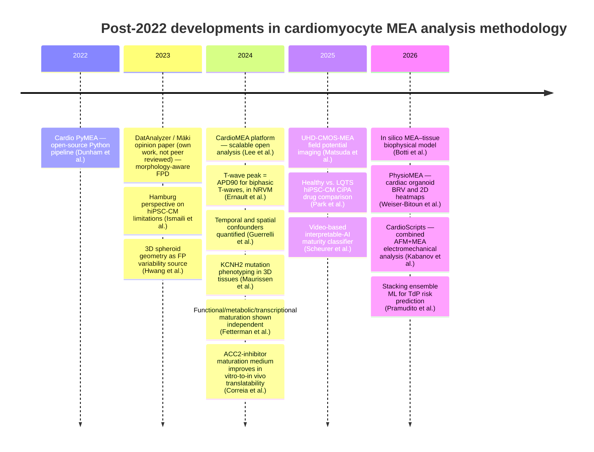
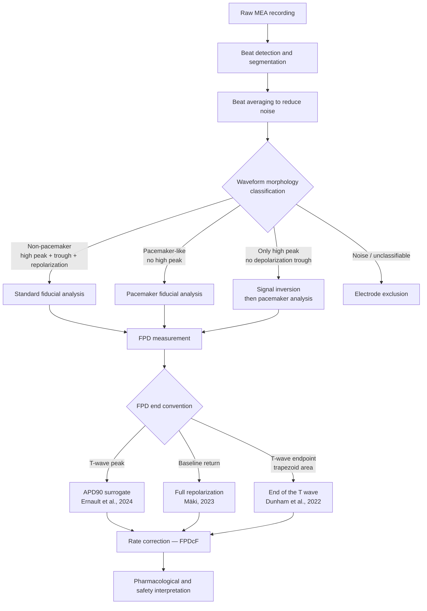

*Preprint, not peer reviewed. Prepared with AI assistance; see Declarations.*

# Abstract

Multielectrode array (MEA) recordings of extracellular field potentials (FPs) from human induced pluripotent stem cell–derived cardiomyocytes (hiPSC-CMs) are central to cardiac safety pharmacology, disease modelling, and proarrhythmia risk assessment. As the scope and complexity of these assays have expanded since 2022, the methods used to analyse FP signals have become a focus of attention as a possible source of inter-study variability. This non-systematic narrative review surveys a small selection of developments in cardiomyocyte MEA analysis methodology from 2022 to the present and compares them with the analysis practices recommended in the author's earlier opinion paper on FP signal analysis. In the studies examined, we identify the emergence of open and transparent software platforms alongside vendor-driven workflows; growing emphasis on physiologically motivated fiducial definitions; structured handling of FP waveform morphology heterogeneity; adaptation of analytical frameworks to three-dimensional cardiac models and computational MEA environments; and expansion into high-throughput and chronic assays, with ultra-high-density electrode arrays and machine learning classifiers among the tools used. **Four methodological gaps are identified** as priorities: (*i*) the absence of a hiPSC-CM–specific rate correction formula for field potential duration (FPD); (*ii*) the absence, in the studies examined, of shared and validated waveform morphology classification criteria; (*iii*) the need for dedicated validation of analytical frameworks in three-dimensional and spatially resolved MEA settings; and (*iv*) the absence of validated MEA-derived reference values for staging the electrophysiological axis of hiPSC-CM maturation status. Until these gaps are addressed, data-driven methods built on MEA parameters may learn differences in analysis methods rather than differences in the cells.

# Introduction

Multielectrode arrays (MEAs) recording extracellular field potentials (FPs) from human induced pluripotent stem cell–derived cardiomyocytes (hiPSC-CMs) are widely used in cardiac safety pharmacology, drug discovery, and disease modelling (Blinova et al., 2018; Altrocchi et al., 2023; Park et al., 2025). The field potential duration (FPD) and related metrics serve as surrogates for repolarization and are integral to initiatives such as the Comprehensive in Vitro Proarrhythmia Assay (CiPA) (Blinova et al., 2018; Park et al., 2025). As the use of MEA-based assays has grown, so has the need for consistent, physiologically meaningful analysis of FP waveforms. This review focuses on how methods and analysis practices in cardiomyocyte MEA studies have evolved since 2022, with an emphasis on open pipelines, fiducial definitions, morphology-aware handling, hiPSC-CM maturation status as an underexamined confound, and the implications of moving from two-dimensional to three-dimensional and high-throughput applications.

## Motivation: why analysis methods became central after 2022
In the studies examined, multielectrode array (MEA) recordings from human induced pluripotent stem cell–derived cardiomyocytes (hiPSC-CMs) are used not only for basic measurements such as beating rate and field potential duration (FPD), but also for mechanistic electrophysiological phenotyping (Maurissen et al., 2024; Park et al., 2025; Park et al., 2026), proarrhythmia risk assessment (Blinova et al., 2018; Pramudito et al., 2026) chronic drug testing (Altrocchi et al., 2023) and recordings repeated over days in culture (Guerrelli et al., 2024). This makes the analysis of the recorded signals important, and signal analysis methods, particularly the definition of fiducial points in field potential (FP) waveforms, are a plausible source of variability and a possible limit to inter-study comparability. The studies reviewed below show that conventions differ and that FPD does not always track the action potential, but none of them measures how much variability analysis methods cause, and a review of cardiac microphysiological systems describes the parametrization of action potentials and field potentials as well established and as enabling clear comparison of results between studies (Vuorenpää et al., 2023).

An opinion paper by the present author (Mäki, 2023) explicitly challenged the physiological validity of commonly used FP annotation conventions, arguing that the widely adopted peak-to-peak definition of FPD is often mismatched to the underlying electrophysiology of cardiomyocytes. In particular, it argues that the first positive FP peak in a propagating hiPSC-CM monolayer may reflect depolarization of neighboring cells rather than the locally recorded cardiomyocyte, and that FPD end should be measured to the return of the signal to baseline rather than the repolarization peak. Broader methodological and biological challenges of hiPSC-CMs as electrophysiological models—including ion channel expression, resting membrane potential, and the identity of cell subtypes—have been discussed from a critical perspective (Ismaili et al., 2023). This critique and these perspectives provide a useful conceptual framework for evaluating post-2022 developments in cardiomyocyte MEA analysis.

# Scope and Literature Search

This is a narrative review of methodological developments in cardiomyocyte MEA analysis from 2022 to the present. It does not follow a formal systematic review protocol (e.g., PRISMA) and does not report search statistics; rather, it synthesises a selection of developments with emphasis on analysis methodology. Candidate papers were identified iteratively with the help of AI research assistants working from the terms like "*multielectrode array*", "*MEA*", "*hiPSC-CM*", "*field potential*", "*FPD*", "*signal analysis*", "*beat detection*", "*rate correction*", and "*cardiotoxicity*", with a primary temporal filter of 2022 to present and contextual coverage of earlier work where relevant, and were supplemented by following the reference lists of included papers and by suggestions from colleagues. A targeted search of PubMed/MEDLINE, bioRxiv, and Scopus on 2 July 2026 was used to check whether MEA-derived reference values for hiPSC-CM maturation had been proposed. For the remaining selection, the databases queried, search dates, numbers of records screened, and explicit inclusion and exclusion criteria were not recorded. The selection should therefore be regarded as non-systematic, and the statements below refer to the studies examined rather than to the literature as a whole. An opinion paper on FP signal analysis (Mäki, 2023), written by the present author, serves as an evaluative anchor: reviewed studies are assessed against the methodological standards and physiological reasoning it articulates. Because this paper is itself not peer reviewed, some of its claims are assessed critically below, and a competing-interest statement is given in the Declarations.

---

# Literature review

*Figure 1. Timeline of key methodological developments in cardiomyocyte MEA analysis, 2022–2026.*

## Open analysis pipelines alongside vendor-defined metrics
Among the studies examined, open and inspectable analysis pipelines specifically designed for cardiomyocyte electrophysiology are a visible alternative to vendor-provided "black-box" software. Such tools are not new, as MultiElec and CardioMDA, for example, existed before 2022 (Dunham et al., 2022; Lee et al., 2024), but several new ones have appeared since 2022, some of them built for new kinds of data such as high-density arrays (Lee et al., 2024) and cardiac organoids (Weiser-Bitoun et al., 2026).
<!-- jatka -->

Cardio PyMEA, introduced in 2022, represents an early example of this transition. This open-source Python-based application enables explicit analysis of cardiomyocyte MEA recordings, including beat detection, pacemaker origin estimation, beat interval and amplitude analysis, local activation time, upstroke velocity, and conduction velocity (Dunham et al., 2022). More recently, the CardioMEA platform (Lee et al., 2024) was built specifically for high-density MEA data: it processes recording files in parallel into an SQL database, offers a web-based dashboard, extracts features from both extracellular and intracellular-like (electroporation-derived) signals, and includes an automated machine-learning module for ranking the features that separate diseased from control lines. PhysioMEA (Weiser-Bitoun et al., 2026) extended this trajectory with a platform whose software, source code and documentation are freely available (written in MATLAB and also distributed as a standalone executable), designed for cardiac organoids and providing one-dimensional biomarkers—FPD, spike amplitude, peak-to-peak duration, and inter-beat interval—across all recording electrodes, two-dimensional spatiotemporal heatmaps that quantify electrode-to-electrode variability in signal propagation, and beat rate variability (BRV) analysis with 45 standardised measures adapted from heart rate variability frameworks.

Together, these platforms point toward reproducibility, transparency, and explicit reporting of analysis parameters, enabling investigators to critically assess how electrophysiological features are derived rather than relying on opaque vendor defaults. The studies examined here do not show that this has displaced vendor software: the studies of Park et al. (2025) and Park et al. (2026), for example, analysed their recordings with the vendor's Cardiac Analysis Tool, and no usage data are available to estimate adoption of the open tools.

*Table 1. Open-source platforms for cardiomyocyte MEA analysis reviewed in this paper. FPD end convention refers to the definition used for the distal boundary of field potential duration. NR = not reported in the source reviewed.*

| Platform | Year | Language | FPD end definition | Distinctive features |
|---|---|---|---|---|
| Cardio PyMEA (Dunham et al., 2022) | 2022 | Python | T-wave endpoint (trapezoid-area algorithm) | Beat detection, LAT, conduction velocity, pacemaker origin estimation |
| DatAnalyzer (Mäki, 2023; author's own tool, not peer reviewed) | 2023 | Python | Baseline return | Morphology-aware classification (3 waveform types); inversion for only-high-peak signals (not independently validated) |
| CardioMEA (Lee et al., 2024) | 2024 | Python | R-to-T-wave peak | High-density MEA; extracellular and intracellular-like signals; parallel processing, web dashboard; automated machine-learning feature ranking; no rate-corrected FPD |
| PhysioMEA (Weiser-Bitoun et al., 2026) | 2026 | MATLAB | R-to-T-wave peak | 1D + 2D spatiotemporal heatmaps; beat rate variability (45 measures) |
| CardioScripts / Myopyth (Kabanov et al., 2026) | 2026 | Python | NR (T peaks detected) | Combined AFM + MEA; electromechanical coupling and decoupling analysis |

## Increasing emphasis on explicit and physiologically motivated fiducial definitions
Alongside the development of open software, there has been a growing emphasis on how fiducial points are defined and justified in cardiomyocyte MEA studies. The opinion paper by Mäki (2023) describes a concrete, algorithmic approach that reflects trends increasingly seen in recent literature: beat-aligned segmentation followed by averaging across multiple beats to reduce noise, threshold-based identification of depolarization onset relative to FP amplitude, and definition of FPD end as the return of the signal toward baseline rather than the repolarization peak.

The open platforms in Table 1 that measure FPD state their convention explicitly, and the conventions differ (CardioScripts reports QT and T-peak rather than FPD; Kabanov et al., 2026):

- **Cardio PyMEA**: from the R peak to a T-wave endpoint located with a trapezoid-area algorithm (Dunham et al., 2022)
- **CardioMEA** (Lee et al., 2024) and **PhysioMEA** (Weiser-Bitoun et al., 2026): from the R peak to the T-wave peak
- **DatAnalyzer**: from depolarization onset to baseline return (Mäki, 2023)

Such transparency is essential because differences in fiducial definitions can influence measured drug effects and rate-corrected FPD or QT surrogates. The physiological validity of specific annotation conventions has received renewed attention: Ernault et al. (2024) demonstrated using simultaneous MEA and sharp-microelectrode recordings from neonatal rat ventricular myocyte (NRVM) monolayers that the peak time of the T wave in FPs correlates strongly with APD90, but only when the T wave displays a biphasic pattern — a morphology the authors report in only a minority of recorded monolayers. This anchors the T-wave peak, when the waveform is biphasic, to APD90. The baseline-return convention was not compared with the action potential in that study, and in monolayers with only a positive T wave the T wave ended before the end of the action potential (Ernault et al., 2024); the two definitions may therefore measure different quantities rather than one being universally more correct. Direct evidence from hiPSC-CMs points in the same cautious direction: in high-density recordings from iCell cardiomyocytes, R-to-T-peak FPD correlated only minimally with APD50 and APD90 measured from intracellular-like signals on the same electrodes, which the authors attribute to small, noisy T waves (Lee et al., 2024). Earlier work with simultaneous video and MEA recordings in iCell monolayers likewise noted that the two FPD end points in use at the time, the peak of the positive deflection and the return of the positive deflection to baseline, appeared to correspond to different phases of the relaxation motion (its upstroke and its peak, respectively), and that an accurate end point was difficult to establish (Hayakawa et al., 2014). These findings underscore the importance of waveform morphology assessment prior to any fiducial-point-based analysis. The robustness of the baseline-return convention has not been examined in the studies reviewed here: Mäki (2023) averages beats to reduce noise, but how the end point behaves at low signal-to-noise ratios or with baseline drift is not evaluated.

*Table 2. Field potential duration (FPD) fiducial definition conventions observed in the reviewed literature. APD90 = action potential duration to 90% repolarization. The T-wave-peak and baseline-return conventions measure different physiological quantities and are not interchangeable.*

| Convention | FPD start | FPD end | Physiological target | Studies |
|---|---|---|---|---|
| Peak-to-peak (R-to-T-peak) | R peak (first positive peak) | T-wave peak | ~APD90 (biphasic T-wave only) | Weiser-Bitoun et al., 2026; Lee et al., 2024; described as a common convention and criticised in Mäki, 2023 |
| Baseline-return | Depolarization onset | Signal return to baseline (threshold-based) | Full repolarization (APD95–100 range) | Mäki, 2023 |
| T-wave endpoint | R wave (field potential peak) | T-wave end from a fitted trapezoid (area-maximisation algorithm) | End of the T wave (QT-like); not validated against APD in the source | Dunham et al., 2022 |
| T-wave peak (biphasic-validated, NRVM) | not defined (T-wave landmarks are tested against APD) | T-wave peak | APD90 — confirmed for biphasic T-waves (minority morphology) by simultaneous AP recording in NRVM, not hiPSC-CM | Ernault et al., 2024 |

## Rate correction of field potential duration (FPDc)
A methodologically critical step in cardiomyocyte MEA analysis is the correction of FPD for spontaneous beating rate. Since hiPSC-CM cultures beat spontaneously at variable rates, the beating rate can change substantially during recordings. Therefore, raw FPD values are confounded by rate-dependent repolarization effects. By analogy with the clinical QT interval, the Fridericia formula ($FPDcF = FPD/RR^{0.33}$) is the correction used in the studies examined here that report rate-corrected FPD (Altrocchi et al., 2023; Hwang et al., 2023; Maurissen et al., 2024; Park et al., 2026); Park et al. (2025) also report corrected FPD but do not name the formula. Ryynänen et al. (2018), a pre-2022 study cited only in the outlook, corrected FPD with Bazett's formula. The convention predates this period: the blinded multisite CiPA study applied Fridericia correction to all 28 reference drugs across ten sites while stating that the formula was not thoroughly validated for hiPSC-CMs (Blinova et al., 2018). A recent proposed acceptance standard for hiPSC-ventricular-CM MEA assays likewise builds the Fridericia correction into quality control, by requiring an FPDc of 200–700 ms (Clements et al., 2025).

However, the application of clinical rate-correction formulas to in vitro hiPSC-CM preparations carries unresolved limitations. One study reported that the beating rate increases by more than 22% and FPD decreases by approximately 8% during a 20-minute recording equilibration period, illustrating the sensitivity of FPD measurements to the precise timing of data acquisition (Guerrelli et al., 2024). If recordings are taken before rate stabilization, FPDc values can be substantially biased regardless of the correction formula applied. Furthermore, a fixed cube-root correction cannot be assumed to hold across the wide range of spontaneous rates of hiPSC-CMs, which are accepted at 20–90 BPM in the multisite CiPA study (Blinova et al., 2018) and 20–80 BPM in a proposed acceptance standard (Clements et al., 2025), meaning the correction formula may systematically under- or over-correct at the extremes of this range. The absence of a hiPSC-CM–specific validated rate correction formula is a recognised methodological gap (Blinova et al., 2018) that directly limits the inter-study comparability of pharmacological FPDc endpoints. Open analysis platforms do not necessarily close it: the published CardioMEA feature set contains FPD but no rate-corrected FPD (Lee et al., 2024). Pacing at a fixed rate would in principle avoid the need for a correction (the author's reasoning), but several of the studies examined recorded spontaneous beating (Clements et al., 2025; Matsuda et al., 2025, who name the absence of pacing as a limitation of their recordings), and Guerrelli et al. (2024) also recorded paced beating. Despite this limitation, FPDc change (ΔFPDc) has become a primary input feature for machine-learning-based proarrhythmic risk classifiers; a stacking ensemble combining random forest, gradient boosting, and neural network classifiers outperformed each of its single constituent classifiers in predicting torsades de pointes (TdP) risk on 16 held-out CiPA reference compounds (Pramudito et al., 2026). Both this study and a patient-line study by Park et al. (2026), which trained neural-network, random-forest and gradient-boosting classifiers on Fridericia-corrected FPDc and other MEA parameters from long QT and Brugada syndrome lines, took the rate correction as given: the former used ΔFPDc values already corrected in the multisite CiPA dataset, and neither tested how the choice of correction affects classifier performance. Both evaluated on small test sets of 15–16 drugs by repeated resampling.

## Maturation status as an unresolved confound for MEA-derived metrics
A further complication for cross-study comparability, distinct from but interacting with rate correction, is that hiPSC-CMs are electrophysiologically immature relative to adult cardiomyocytes, and this maturation state is rarely quantified in MEA studies beyond loosely controlling culture duration. hiPSC-CMs retain an immature, fetal-like phenotype (Correia et al., 2024; Scheurer et al., 2025) and express ion channels that are absent from adult human working myocardium, notably the funny current (If) and occasionally the T-type Ca²⁺ current, although the presence of the latter is not necessarily a sign of immaturity; whether ventricular-, atrial-, and nodal-like cells form distinct subpopulations within the same preparation is debated (Ismaili et al., 2023), but patch-clamp data show them in the lines of Park et al. (2026). Because FPD, its rate correction, and waveform morphology are all measured on cells whose maturity is not routinely reported, two laboratories could report different pharmacological endpoints for the same compound simply because their cultures differ in maturation state rather than in analysis methodology. Guerrelli et al. (2024) provide direct evidence of this within an MEA context: FPD lengthens by approximately 257 ms and beating rate declines over days 2–14 in culture, alongside a 27.5-fold increase in KCNJ2 (I_K1-encoding) gene expression over 30 days — an electrophysiological drift consistent with ongoing maturation, which rate correction alone does not address.

A recent high-throughput study outside the MEA-FP literature narrows what such a metric could reasonably claim to measure. Fetterman et al. (2024) systematically added and removed individual components of a defined maturation medium and compared nine medium formulations by RNA sequencing, and found that functional (electrophysiology/excitation-contraction coupling), metabolic, and transcriptional maturation are induced largely independently by different medium components: for example, removing fatty acids lowered mitochondrial respiration without changing Ca²⁺ dynamics. This implies that hiPSC-CM maturation is not a single scalar quantity, and that any MEA-derived reference value — which by construction can only observe the electrophysiological compartment — would characterize one axis of maturity rather than a preparation's overall maturation status. No peer-reviewed 2022–present study proposing or validating such MEA-only maturation reference values was identified in a targeted search of PubMed/MEDLINE, bioRxiv and Scopus (2 July 2026); the closest development is an industry-led proposal (Axion BioSystems' "AIMS \#CM01", presented as a poster at ISSCR 2025; Clements et al., 2025) defining minimum well-acceptance criteria for spontaneous-beating hiPSC-ventricular-CM MEA assays (spike amplitude ≥ 0.5 mV and synchronized beating on at least half of the electrodes, a spontaneous beat period of 750–3000 ms, and FPDc of 200–700 ms), which targets assay quality control rather than maturation staging and has been presented as a conference poster and vendor document rather than a peer-reviewed methods paper.

Two further studies sharpen this picture without closing the gap. Correia et al. (2024) developed a maturation medium — a galactose- and fatty-acid-based formulation with a triiodothyronine/IGF-1/dexamethasone cocktail, augmented with a small-molecule Acetyl-CoA carboxylase 2 (ACC2) inhibitor — that improved patch-clamp-defined electrophysiological maturity (a more hyperpolarized maximum diastolic potential, faster action potential upstroke velocity, and a six-fold increase in inward-rectifier K⁺ current) alongside metabolic and structural maturation. Critically, an in vitro-to-in vivo target-engagement correlation (in vitro IC50 against in vivo IC50 in rat plasma) across 21 inhibitors of one drug target, BCKDK, was achieved only in matured cells (Pearson r = 0.85, R² = 0.72, p < 0.0001, data spanning roughly three orders of magnitude), while standard-medium cells showed no significant response to BCKDK inhibition — not merely a weaker correlation, but no correlation that could be computed — providing evidence, for this target, that maturation status can gate translational validity rather than being a secondary methodological concern. Separately, Scheurer et al. (2025) showed that an interpretable machine-learning classifier — a support vector machine with Shapley-value feature attribution — can distinguish early immature (day 21) from more mature (day 42, maturation medium) iPSC-CM cultures with 99.5% accuracy on a hold-out test set of 46 videos, using only non-invasive, video-based beating features, and cited prior evidence that field potential duration and contraction–relaxation duration are linearly related across drug concentrations in iPSC-CMs, with a different slope for each drug and under non-arrhythmic conditions (Hayakawa et al., 2014). Taken together, these findings indicate that the components required for an MEA-native maturity classifier — a validated interpretable-machine-learning methodology, a reported physiological link between FPD and contraction, and a demonstrated translational stake in getting maturation staging right — already exist in the literature, but have not yet been assembled into a validated, MEA-derived maturation reference value.

## Morphology-aware analysis and handling of heterogeneous FP waveforms
Another important methodological development in recent cardiomyocyte MEA studies is the recognition that FP waveform morphology varies substantially across preparations, maturation states, and recording conditions. Pacemaker-like signals lacking a pronounced high peak, waveforms dominated by a single peak, and mixed or atypical morphologies are described in hiPSC-CM cultures (Mäki, 2023), and hiPSC-CM preparations contain nodal-like cells (Park et al., 2026).

The opinion paper explicitly addresses these cases by proposing morphology-aware handling strategies, including specialized interpretation of pacemaker-like signals and pragmatic preprocessing — such as waveform inversion for "only high peak" cases, an approach internally validated in that work but not yet independently replicated — prior to standard analysis (Mäki, 2023).

*Figure 2. Schematic of a morphology-aware field potential analysis pipeline. Waveform classification determines the analysis branch applied before FPD measurement; rate correction is applied after. The signal-inversion branch is the author's own proposal (Mäki, 2023) and has not been independently validated.*

The studies examined do not adopt identical rules, but two of them show an awareness of waveform heterogeneity: they report morphology-dependent analysis branches or document that T-wave morphology varies between preparations, which indicates that a single canonical FP shape cannot be assumed (Ernault et al., 2024; Weiser-Bitoun et al., 2026). Whether this differs from earlier studies was not assessed here. Nonetheless, fiducial definitions remain inconsistent across open platforms: PhysioMEA, for instance, defines FPD as the interval from the R-peak to the T-wave peak (Weiser-Bitoun et al., 2026) rather than the return to baseline (Mäki, 2023), and FPD values are therefore not directly comparable across tools without explicit knowledge of the underlying convention.

## Model complexity: 3D cardiomyocyte systems and in silico models of the MEA
Three-dimensional (3D) cardiomyocyte models, including spheroids and engineered cardiac tissues, are a setting in which FP analysis heuristics originally developed for two-dimensional monolayers may not transfer directly. In silico three-dimensional models of hiPSC-CM spheroids on MEAs, compared with in vitro recordings, produced highly variable field potential shapes that depended on the stimulation and electrode locations even with a single cell type, indicating that three-dimensionality itself contributes to FP variability (Hwang et al., 2023).

Mutation-specific disease modelling has extended MEA use in 3D isogenic tissues: Maurissen et al. (2024) combined gene-edited *KCNH2* variants (N588D, N588K) with hiPSC-derived cardiac tissue sheets and MEA analysis to recapitulate long QT and short QT phenotypes, with differential repolarization and susceptibility to pharmacologically induced arrhythmias. These findings reinforce the caution raised by Mäki (2023) that analysis frameworks optimized for 2D cultures may not be directly transferable to 3D systems without modification. The two studies discussed here state the model format explicitly; whether model-aware quality control and interpretation are becoming general practice was not assessed. Complementing the experimental work, in silico approaches model the MEA itself. A two-dimensional bidomain model of a six-well MEA with phenotype-specific ventricular-like and atrial-like ionic models simulated how the atrial-like fraction changes conduction velocity and repolarization, reproduced Brugada-like field potentials, and compared simulated effects of four ion-channel blockers with previously published MEA data, although without new experiments and with a fixed 30% atrial-like fraction in the drug simulations (Botti et al., 2026). It is a monolayer model and therefore does not address the 3D question directly.

## High-throughput and longitudinal assays drive broader feature sets
Finally, several of the post-2022 studies examined address high-throughput and chronic applications, particularly in cardiotoxicity and proarrhythmia screening. These applications require stable beat detection, robust handling of arrhythmic events, and consistent analysis across extended recording periods and large historical datasets.

A chronic MEA assay with repeated recordings over four days has been validated for both acute and delayed cardiotoxicity (Altrocchi et al., 2023). Altrocchi et al. (2023) used 48-well MEA plates to evaluate acute (<2 h) and delayed (≥24 h) electrophysiological and cytotoxic effects of reference compounds—including tyrosine-kinase inhibitors, an anthracycline (doxorubicin), and ion-channel trafficking inhibitors—over 4 days, combining field potential recordings with impedance readouts, on a platform the authors describe as medium-throughput. Park et al. (2025) compared eight arrhythmia-inducing drugs (e.g. E4031, moxifloxacin, quinidine) across healthy and long QT syndrome–derived hiPSC-CM lines via MEA, demonstrating dose-dependent FPD and arrhythmogenic risk and disease-specific sensitivity to hERG blockade. The same group later applied a similar MEA workflow to patient-derived long QT and Brugada syndrome lines and 28 compounds, again reporting disease-specific drug sensitivities (Park et al., 2026); as the two studies share their group, platform and apparently a long QT line, they are better read as one body of evidence than as independent replication, and the two Brugada lines consisted largely of atrial-like cells, so their comparison with ventricular-like normal lines is confounded by cell identity. In the studies examined, single conventional metrics are complemented by multi-parameter feature sets encompassing beat rate, beat-to-beat variability, conduction properties, and event-based descriptors (Altrocchi et al., 2023; Matsuda et al., 2025). This further increases the importance of clearly defined analysis methods, since temporal drift and culture equilibration effects can confound interpretation if fiducial definitions and quality control criteria are not explicitly reported. Guerrelli et al. (2024) quantified these dynamics directly, reporting that beating rate increases by 22.6% and FPD decreases by 7.7% over a 20-minute equilibration window, and that from 2 to 14 days in culture the beating rate decreases while FPD lengthens substantially — findings that highlight the necessity of standardizing recording time points and culture age across laboratories. Hardware advances have further broadened the feature set available for high-throughput analysis: ultra-high-density CMOS-MEA platforms with close to a quarter million electrodes enable spatially resolved extraction of excitation origin counts, propagation area, and conduction velocity maps in addition to conventional endpoints such as beat rate and inter-beat interval, and detected doxorubicin-induced cardiotoxicity at 0.03 µM within 24 h, a concentration 10-fold lower than reported in earlier studies (Matsuda et al., 2025). Expanding the feature set beyond purely electrical endpoints, CardioScripts (Kabanov et al., 2026) — an open-source Python toolbox tested on HL-1 cells and hESC-derived embryoid bodies — integrates MEA-based field potential analysis with simultaneous atomic force microscopy (AFM) recordings to quantify electromechanical coupling and decoupling, with dose-dependent lidocaine effects demonstrating that electrical and mechanical signals can dissociate in ways that neither modality detects alone.

---

# Discussion and future outlook

The developments above concern how FP signals are annotated, corrected and interpreted. Two directions that go beyond them are outlined here. Both are prospective views of the present author, build on the author's opinion paper (Mäki, 2023; see the references therein) and are not results of the studies reviewed; they should be read as hypotheses, not as findings.

**Multimodal recordings and AI-assisted sensor fusion.** Several of the studies examined already add a second measurement to the MEA recording: impedance read alongside FP (Altrocchi et al., 2023), intracellular-like signals obtained through the same electrodes by electroporation (Lee et al., 2024), and contraction force from simultaneous atomic force microscopy (Kabanov et al., 2026), whose synchronous validation was done on embryoid bodies only. Earlier work recorded image-based motion and MEA field potentials simultaneously in hiPSC-CM monolayers and found linear relationships between contraction–relaxation duration and FPD across drug concentrations, with drug-specific slopes (Hayakawa et al., 2014). Video-based beating features have also been classified with an interpretable machine-learning model, although without MEA data (Scheurer et al., 2025), and an MEA with transparent electrodes has been used to record the field potential and the video-based motion of the same single hPS-CM at the same time, although the two recordings were not automatically synchronised (Ryynänen et al., 2018). In these studies the modalities are mostly analysed separately or side by side. The hypothesis here is that interpreting them jointly (sensor fusion), with AI support, could give a more complete picture of a preparation than any single signal, for example by adding MEA-derived parameters to a video-based classifier of maturation status. A review of cardiac microphysiological systems likewise sees potential in combining different measurement modalities, which heart-on-chip systems can monitor concurrently (Vuorenpää et al., 2023). The proposal is not to feed raw MEA signals to a model, which the author has doubted would work given how much FP amplitude, frequency and shape differ between cultures (Mäki, 2023). Instead, several of the parameters discussed in this review (for example FPD, amplitude and beat interval) would be extracted from detected peaks and combined with parameters from the other measurements as inputs to machine-learning models, which is the two-step approach of the opinion paper. The peak-detection step may be a challenge if real-time analysis is wanted. A further caution is that machine-learning classifiers in the studies examined were trained on small datasets (Scheurer et al., 2025; Park et al., 2026; Pramudito et al., 2026).

**Separating the recording system from the cellular signal.** An FP is the cellular signal as shaped by the surrounding tissue and by the recording hardware, and several of the studies examined show that FP features do not map directly onto the action potential (AP). The T-wave peak tracks APD90 only when the T wave is biphasic (Ernault et al., 2024), and R-to-T-peak FPD correlated only minimally with APD50 and APD90 from intracellular-like signals on the same electrodes (Lee et al., 2024). Forward modelling already includes the electrode: a bidomain model with a resistor–capacitor electrode model simulates FPs from phenotype-specific cell models (Botti et al., 2026). The hypothesis is the inverse direction, working backwards from the measured signal: by reverse engineering, for example with system identification, the contribution of the MEA device (and, as far as possible, the tissue) could be estimated and separated from the measured signal, so that the remaining signal resembles the cellular AP more closely and measures cell-level changes and drug responses more directly (Mäki, 2023; see the references therein). Electroporation through the recording electrodes (Lee et al., 2024) yields paired FP and AP-like signals from the same electrodes and is therefore a candidate source of training and validation data, and AI-assisted sensor fusion of further simultaneous modalities could add ground truth. The recording-side contribution may also change during an experiment. In the chronic assay of Altrocchi et al. (2023), a background impedance signal was recorded alongside the FP; the authors describe a drop in impedance when the cells attach less well to the bottom of the well, owing to cell death or changes in the monolayer morphology, and used it as a readout of cytotoxicity to help separate electrophysiological effects from cell death. The hypothesis here is that such an impedance channel could also indicate FP changes that stem from altered attachment, and thus from altered coupling between cells and electrodes, rather than from changes in the AP of the cells themselves. Whether FP features change measurably with attachment alone was not tested in that study, and this is the author's reasoning, not a finding of the studies reviewed. Whether the AP can be recovered from the FP at all is an open question: the FP also depends on current from neighbouring cells (Ernault et al., 2024), so removing the device contribution alone would not be sufficient. The recovery may also be an ill-posed inverse problem, because a field potential is a weighted sum of the transmembrane currents of many surrounding cells; this is the author's reasoning from extracellular recording theory and not a finding of the studies reviewed. A calibrated model of the cells, tissue and device, with parameters fitted to the measured signals, could be called a digital twin of the recording. The forward model of Botti et al. (2026) is the closest existing component among the studies examined, but it was not fitted to new measurements. The same review notes that continuous, multimodal measurements give a holistic data set for parameterising and validating computational models and that, to its authors' knowledge, integrative simulations of all building blocks of a microphysiological system had not been published (Vuorenpää et al., 2023). If this worked, it would also make FP-derived results from different hardware more comparable, which is the inference of the present author and has not been tested.

---

# Limitations of this review

This review has the following limitations. (i) The selection of studies is non-systematic and was assembled with AI assistance and by citation tracing (see Scope), so it is neither exhaustive nor reproducible as a search, and it may over-represent particular groups and journals. (ii) The evidence base is small and uneven: most methodological statements rest on one or two studies, some on rat cells (Ernault et al., 2024), simulations (Hwang et al., 2023; Botti et al., 2026) or non-MEA modalities (Fetterman et al., 2024; Scheurer et al., 2025), and no usage or prevalence data were collected, so statements about trends in practice (for example the adoption of open tools) are illustrative only. (iii) The review was written by a single author without independent screening, data extraction or risk-of-bias assessment. (iv) The evaluative framework is the author's own opinion paper (Mäki, 2023), which is not peer reviewed; some of its claims, such as waveform inversion for "only high peak" signals, have not been independently replicated, and its FPD-end convention is only one of several in use (Table 2). (v) Full texts were consulted wherever available, but figures were not inspected for all of them, and supplementary data files such as videos and raw tables were generally not examined. (vi) A few works from before 2022, such as Blinova et al. (2018), Hayakawa et al. (2014) and Ryynänen et al. (2018), are cited only as background for conventions, datasets and earlier multimodal work that later studies build on; they are not themselves among the post-2022 developments reviewed. (vii) The Discussion and future outlook section is speculative: it states hypotheses of the author, builds on the author's own opinion paper (Mäki, 2023), and none of its proposals was tested in the studies examined.

---

# Conclusion

In the studies examined here, cardiomyocyte MEA analysis since 2022 shows a methodological development from opaque, vendor-defined workflows toward transparent, physiologically reasoned, and model-conscious practices. The appearance of open analysis platforms, explicit fiducial annotation, morphology-aware quality control, and model-specific interpretation points toward progress in inter-study comparability, although vendor software remains in use in several of the studies reviewed and the evidence base is small.

Four methodological gaps stand out as priorities. First, **FPD rate correction remains unsolved**: the Fridericia formula, borrowed from clinical electrocardiography, lacks formal validation for the beating rate range and rate–FPD relationship characteristic of hiPSC-CM cultures. Developing a cell-type–specific correction formula — ideally derived from large multi-laboratory datasets — would substantially improve the reliability of FPDc as a pharmacological endpoint. Second, **shared, validated waveform morphology classification criteria were not identified**: in the studies examined, morphology handling is described case by case (analysis of inverted signals, exclusion of electrodes, interpretation restricted to biphasic T waves; Mäki, 2023; Ernault et al., 2024; Weiser-Bitoun et al., 2026) rather than through common criteria, whereas quantitative acceptance criteria exist for well acceptance (amplitude, rate, beat period; Blinova et al., 2018; Clements et al., 2025). Standardised morphology assessment analogous to these acceptance thresholds might reduce between-study variability at the data collection stage, which is a proposal and not a tested effect. Third, **the transfer of 2D-calibrated analysis frameworks to 3D models and ultra-high-density platforms proceeds empirically**: dedicated validation of fiducial definitions and conduction metrics in 3D cardiac tissues and spatially resolved MEA recordings is needed before these endpoints can be used with confidence in pharmacological settings. Fourth, **hiPSC-CM maturation status lacks MEA-derived reference values**: no validated benchmark currently allows a laboratory to report how mature its preparation was at the time of recording, comparable to how FPDc reports how rate-corrected a measurement is. Because functional, metabolic, and transcriptional maturation are induced independently (Fetterman et al., 2024), such a benchmark would necessarily be scoped to the electrophysiological axis alone — but even a partial, MEA-observable maturity reference would materially improve inter-study comparability and strengthen the basis for translating MEA findings to adult clinical myocardium, a stake made concrete by the finding, for one drug target, that in vitro-to-in vivo correlation was obtained only in matured cells (Correia et al., 2024). Notably, the pieces required to build such a reference already exist separately in the literature — an interpretable machine-learning approach validated on non-invasive beating features (Scheurer et al., 2025) and a reported link between field potential duration and contraction duration (Hayakawa et al., 2014; also cited by Scheurer et al., 2025) — but have not yet been combined into an MEA-native equivalent.

Looking forward, machine learning is used in several of the studies examined — from ensemble classifiers for TdP risk prediction (Pramudito et al., 2026) and genotype-specific risk models (Park et al., 2026) to automated feature ranking in an open platform (Lee et al., 2024) — and it may become a more integral layer of cardiomyocyte MEA workflows. Two further directions, AI-assisted fusion of MEA with other measurements and the separation of the recording system from the cellular signal, are outlined as hypotheses in the Discussion and future outlook section. Open analysis software and explicitly reported fiducial definitions are a precondition for this: without them, models built on MEA parameters may reproduce the inconsistencies between studies instead of revealing biological effects.

---

# Declarations

**Status.** This is a preprint and has not been peer reviewed.

**Competing interests.** The author wrote the opinion paper used here as the evaluative framework (Mäki, 2023) and the *DatAnalyzer* tool listed in Table 1, and therefore has an interest in how they are assessed. Several authors of the review Vuorenpää et al. (2023) and of Ryynänen et al. (2018), both cited in the outlook, are colleagues of the author from the Centre of Excellence in Body-on-Chip Research ([CoEBoC](https://research.tuni.fi/coeboc/)) research collaboration at Tampere University; the author is not an author of either. No other competing interests are declared.

**Version note.** "Mäki (2023)" refers to the opinion paper whose first version was posted on Zenodo in 2023; the text assessed here is version v3 of the same record, published on 23 June 2026, which slightly updated the original text (mainly outlook).

**Use of AI assistance.** Large language model agents (Anthropic's Claude, used through the Claude Code tool; Cursor in very early versions) assisted with literature searching and screening, summarising sources into a structured set of notes, checking citations and drafting and editing this text. The author selected the sources, directed and reviewed the work, and is responsible for the content. Bibliographic details were checked against the source documents or publisher records where these were accessible, and a consistency script verifies that every in-text citation appears in the reference list.

**Funding.** This work was carried out as an independent, unfunded project and received no external funding.

**Licence.** This text is released under the Creative Commons Attribution 4.0 International licence (CC BY 4.0).

**Data and code availability.** The source notes and operation log used to prepare this review are available at https://github.com/AnaHill/MEA_review_llm_wiki.

---

# References

Altrocchi, C., Van Ammel, K., Steemans, M., Kreir, M., Tekle, F., Teisman, A., Gallacher, D. J., & Lu, H. R. (2023). Evaluation of chronic drug-induced electrophysiological and cytotoxic effects using human-induced pluripotent stem cell-derived cardiomyocytes (hiPSC-CMs). *Frontiers in Pharmacology*, *14*, 1229960. https://doi.org/10.3389/fphar.2023.1229960

Blinova, K., Dang, Q., Millard, D., Smith, G., Pierson, J., Guo, L., Brock, M., Lu, H. R., Kraushaar, U., Zeng, H., Shi, H., Zhang, X., Sawada, K., Osada, T., Kanda, Y., Sekino, Y., Pang, L., Feaster, T. K., Kettenhofen, R., . . . Gintant, G. (2018). International multisite study of human-induced pluripotent stem cell-derived cardiomyocytes for drug proarrhythmic potential assessment. *Cell Reports*, *24*(13), 3582–3592. https://doi.org/10.1016/j.celrep.2018.08.079

Botti, S., Krause, R., & Pavarino, L. F. (2026). In silico modelling of multi-electrode arrays for enhancing cardiac drug testing on hiPSC-CM heterogeneous tissues. *The Journal of Physiology*, *604*(19), 8141–8166. https://doi.org/10.1113/JP287276

Clements, M., Altrocchi, C., Guerrelli, D., Hill, A. P., Posnack, N., Strock, C., & Yoshinaga, T. (2025, June 11). *Standards for hiPSC-derived cardiomyocyte electrophysiology using the MEA assay* [Poster presentation]. ISSCR 2025, Hong Kong. https://axionbiosystems.com/resources/poster/standards-hipsc-derived-cardiomyocyte-electrophysiology-using-mea-assay

Correia, C., Christoffersson, J., Tejedor, S., El-Haou, S., Matadamas-Guzman, M., Nair, S., Dönnes, P., Musa, G., Rohman, M., Sundqvist, M., Riddle, R. B., Nugraha, B., Sorzabal Bellido, I., Johansson, M., Wang, Q.-D., Hidalgo, A., Jennbacken, K., Synnergren, J., & Später, D. (2024). Enhancing maturation and translatability of human pluripotent stem cell-derived cardiomyocytes through a novel medium containing acetyl-CoA carboxylase 2 inhibitor. *Cells*, *13*(16), 1339. https://doi.org/10.3390/cells13161339

Dunham, C. S., Mackenzie, M. E., Nakano, H., Kim, A. R., Nakano, A., Stieg, A. Z., & Gimzewski, J. K. (2022). Cardio PyMEA: A user-friendly, open-source Python application for cardiomyocyte microelectrode array analysis. *PLOS ONE*, *17*(5), e0266647. https://doi.org/10.1371/journal.pone.0266647

Ernault, A. C., Al-Shama, R. F. M., Li, J., Devalla, H. D., de Groot, J. R., Coronel, R., Vigmond, E., & Boukens, B. J. (2024). Interpretation of field and LEAP potentials recorded from cardiomyocyte monolayers. *American Journal of Physiology–Heart and Circulatory Physiology*, *326*(3), H800–H811. https://doi.org/10.1152/ajpheart.00463.2023

Fetterman, K. A., Blancard, M., Lyra-Leite, D. M., Vanoye, C. G., Fonoudi, H., Jouni, M., DeKeyser, J.-M. L., Lenny, B., Sapkota, Y., George, A. L., Jr., & Burridge, P. W. (2024). Independent compartmentalization of functional, metabolic, and transcriptional maturation of hiPSC-derived cardiomyocytes. *Cell Reports*, *43*, 114160. https://doi.org/10.1016/j.celrep.2024.114160

Guerrelli, D., Pressman, J., Salameh, S., & Posnack, N. (2024). hiPSC-CM electrophysiology: impact of temporal changes and study parameters on experimental reproducibility. *American Journal of Physiology–Heart and Circulatory Physiology*, *327*(1), H12–H27. https://doi.org/10.1152/ajpheart.00631.2023

Hayakawa, T., Kunihiro, T., Ando, T., Kobayashi, S., Matsui, E., Yada, H., Kanda, Y., Kurokawa, J., & Furukawa, T. (2014). Image-based evaluation of contraction–relaxation kinetics of human-induced pluripotent stem cell-derived cardiomyocytes: Correlation and complementarity with extracellular electrophysiology. *Journal of Molecular and Cellular Cardiology*, *77*, 178–191. https://doi.org/10.1016/j.yjmcc.2014.09.010

Hwang, M., Lee, S.-J., Lim, C.-H., Shim, E. B., & Lee, H.-A. (2023). The three-dimensionality of the hiPSC-CM spheroid contributes to the variability of the field potential. *Frontiers in Physiology*, *14*, 1123190. https://doi.org/10.3389/fphys.2023.1123190

Ismaili, D., Schulz, C., Eschenhagen, T., Christ, T., Hansen, A., Mika, D., Koivumäki, J. T., & Horváth, A. (2023). Human induced pluripotent stem cell-derived cardiomyocytes as an electrophysiological model: Opportunities and challenges—The Hamburg perspective. *Frontiers in Physiology*, *14*, 1132165. https://doi.org/10.3389/fphys.2023.1132165

Kabanov, D. A., Vrana, S., Beckerová, D., Rotrekl, V., Pesl, M., & Přibyl, J. (2026). A comprehensive system of algorithms for characterization of cardiomyocyte mechanical and electrical function. *Biomedical Signal Processing and Control*, *120*, 110125. https://doi.org/10.1016/j.bspc.2026.110125

Lee, J., Duperrex, E., El-Battrawy, I., Hohn, A., Saguner, A. M., Duru, F., Emmenegger, V., Cyganek, L., Hierlemann, A., & Ulusan, H. (2024). CardioMEA: comprehensive data analysis platform for studying cardiac diseases and drug responses. *Frontiers in Physiology*, *15*, 1472126. https://doi.org/10.3389/fphys.2024.1472126

Mäki, A.-J. (2023). *Opinion: The correct way to analyze FP signals* (Version v3, published 23 June 2026) [Report]. Zenodo. https://doi.org/10.5281/zenodo.20807245

Matsuda, N., Nagafuku, N., Matsuda, K., Ishibashi, Y., Taniguchi, T., Matsushita, Y., Miyamoto, N., Yoshinaga, T., & Suzuki, I. (2025). Advanced cardiotoxicity profiling using field potential imaging with UHD-CMOS-MEA in human iPSC-derived cardiomyocytes. *Toxicological Sciences*, *208*(2), 384–400. https://doi.org/10.1093/toxsci/kfaf134

Maurissen, T. L., Kawatou, M., López-Dávila, V., Minatoya, K., Yamashita, J. K., & Woltjen, K. (2024). Modeling mutation-specific arrhythmogenic phenotypes in isogenic human iPSC-derived cardiac tissues. *Scientific Reports*, *14*, 2586. https://doi.org/10.1038/s41598-024-52871-1

Park, N. K., Park, Y.-G., Choi, J.-H., Choi, H. K., Moon, S.-H., Park, S.-J., & Choi, S. W. (2025). Human induced pluripotent stem cell-cardiomyocytes for cardiotoxicity assessment: a comparative study of arrhythmia-inducing drugs with multi-electrode array analysis. *Korean Journal of Physiology & Pharmacology*, *29*(2), 257–269. https://doi.org/10.4196/kjpp.24.413

Park, Y.-G., Park, N. K., Lee, Y., Pramudito, M. A., Son, Y.-J., Park, H., Qauli, A. I., Choi, S. W., Ban, K., Choi, J.-I., Park, S.-J., Park, H.-J., Lim, K. M., Koo, S. K., Kim, J.-H., & Moon, S.-H. (2026). A machine learning platform for genotype-specific cardiotoxicity risk prediction using patient-derived iPSC-CMs. *Journal of Advanced Research*, *82*, 381–396. https://doi.org/10.1016/j.jare.2025.07.030

Pramudito, M. A., Fuadah, Y. N., Kim, Y. S., & Lim, K. M. (2026). Stacking ensemble machine learning for cardiac safety assessment using hiPSC-CM MEA data. *Annals of Biomedical Engineering*, *54*, 1334–1344. https://doi.org/10.1007/s10439-026-03978-1

Ryynänen, T., Pekkanen-Mattila, M., Shah, D., Kreutzer, J., Kallio, P., Lekkala, J., & Aalto-Setälä, K. (2018). Microelectrode array for noninvasive analysis of cardiomyocytes at the single-cell level. *Japanese Journal of Applied Physics*, *57*, 117001. https://doi.org/10.7567/JJAP.57.117001

Scheurer, F., Hammer, A., Schubert, M., Steiner, R.-P., Gamm, O., Guan, K., Sonntag, F., Malberg, H., & Schmidt, M. (2025). Non-invasive maturity assessment of iPSC-CMs based on optical maturity characteristics using interpretable AI. *Computational and Structural Biotechnology Journal*, *27*, 3719–3728. https://doi.org/10.1016/j.csbj.2025.08.024

Vuorenpää, H., Björninen, M., Välimäki, H., Ahola, A., Kroon, M., Honkamäki, L., Koivumäki, J. T., & Pekkanen-Mattila, M. (2023). Building blocks of microphysiological system to model physiology and pathophysiology of human heart. *Frontiers in Physiology*, *14*, 1213959. https://doi.org/10.3389/fphys.2023.1213959

Weiser-Bitoun, I., Mazgaoker, S., Assayag, S., Davoodi, M., Alexandrovich, A., & Yaniv, Y. (2026). PhysioMEA: Signal processing platform for rate and rhythm analysis of multi-electrode array cardiac electrophysiological recordings. *Journal of Molecular and Cellular Cardiology*, *210*, 137–149. https://doi.org/10.1016/j.yjmcc.2025.11.006
