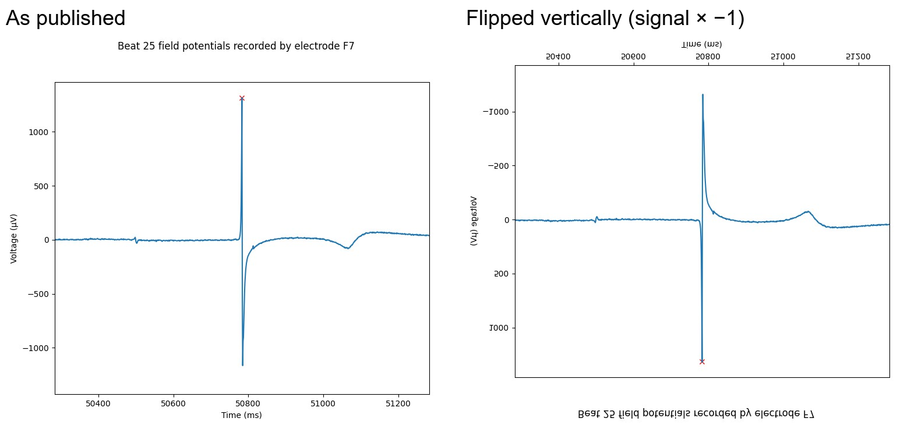
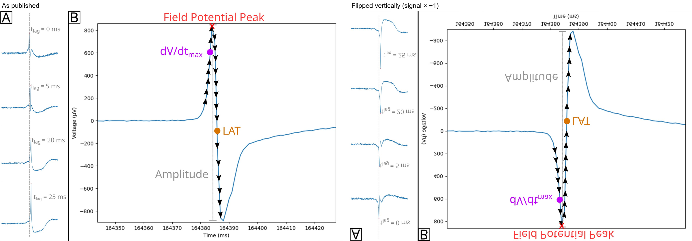
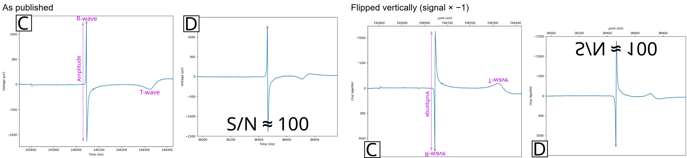

# Field potential polarity: the Cardio PyMEA example recordings

Concept page, written 2026-11-05 from a discussion with the researcher about Figures 4–6 of Dunham et al. (2022). It records a question that is a side thread for the review: are the example recordings of Cardio PyMEA shown with the polarity that their physiological reading assumes, and what would follow if they were read the other way? Only a short, neutral observation went into main.md (morphology section, see the end of this page); the rest is kept here as the researcher's hypothesis and our reading of published figures, not as findings.

## Figures

Each image shows the figure as published (left) and flipped vertically (right). The flipped version is the image mirrored top to bottom, so the signal is multiplied by −1 as displayed and the axis labels and text are mirrored with it; in Figure 5A the stacked traces also reverse their order, so tlag = 0 ms is at the bottom. Images extracted from `raw/dunham-2022-cardiopyemea.pdf` on 2026-11-05 (embedded figure images of pp. 7, 9 and 12, cropped).

Source and licence: adapted from Dunham, C. S., et al. (2022). Cardio PyMEA: A user-friendly, open-source Python application for cardiomyocyte microelectrode array analysis. *PLOS ONE*, 17(5), e0266647. https://doi.org/10.1371/journal.pone.0266647. © 2022 Dunham et al., Creative Commons Attribution License. Changes: cropped, flipped vertically, labels added.

*Figure 4, left plot (beat 25 recorded by electrode F7).*

*Figure 5A–B (time lag, dV/dtmax, LAT and amplitude; panel C omitted).*

*Figure 6C–D (C: R wave, amplitude and T wave; D: S/N ≈ 100; panels A–B, E–F omitted).*

## What the source says

From `raw/dunham-2022-cardiopyemea.pdf` (text layer in `figure_analysis/dunham-2022-cardiopyemea/text.txt`):

- **Beat detection:** "Cardiomyocyte beats, identified in MEAs as the most prominent peak of the field potential, are calculated by Cardio PyMEA using the findpeaks function contained in the SciPy library", with a user-set minimum peak height (Methods, beat detection).
- **R wave:** "the R-wave is analogous to the field potential peak" (p. 10, FPD calculation).
- **Local activation time:** "finding the maximal negative intrinsicoid deflection (the maximum negative derivative (-dV/dt) to the right of the field potential peak in a given beat)" (LAT calculation, Figure 5B); "The maximum decrease in field potential voltage is generally accepted as the activation time for a beat [39]" (p. 13).
- **Upstroke velocity:** dV/dtmax is taken on the rising edge before the FP peak (Figure 5B) and "is associated with the peak influx of sodium and calcium ions during the action potential" (p. 13).
- **Pacemaker time lag:** the FP peak is found on each electrode and the earliest is set to 0 ms (Figure 5A).
- **Recording system:** 120-electrode Multichannel Systems MEAs, input as MC_Data .txt exports. The paper does not state the polarity convention of the recording or of the plots.

## What the figures show (our reading)

- Figures 4, 5B and 6C–D: a sharp positive peak (about +800 to +1300 µV), a steep fall to a negative trough of similar size, a slow return from below baseline over roughly 100 ms, and a negative T wave a few hundred ms later.
- Figure 5A: the electrode with time lag 0 ms (earliest in the array) shows a dominant positive peak with a small negative undershoot; electrodes at 20–25 ms show a tall positive peak and a deep negative trough.

## Two readings of the same waveform

**As published (the polarity Cardio PyMEA assumes).** A propagating wave: positive as the wavefront approaches, steep negative deflection as it passes the electrode (local activation, Dunham's LAT), negative afterwards; the T wave is negative. In the classification of Mäki (2023) this is the non-pacemaker type (high peak before the trough), and DatAnalyzer would not invert it, since it inverts only signals without a low peak ("find low peaks; if there isn't any, only high peaks, just turn the signal").

**Inverted (the researcher's hypothesis, 2026-11-05).** Read with the opposite sign, the waveform resembles the pacemaker-like signals of Mäki (2023): (i) the first, downward spike would be the depolarization of the pacemaker cell, and (ii) the large positive peak after it would be a repolarization-related, somewhat abnormal peak that precedes EAD-like behaviour, the signal not returning cleanly to baseline after the depolarization spike. The repolarization phase, negative as published, becomes positive.

## Arguments

For the inverted reading:

- If the FP approximates −dVm/dt, as Mäki (2023, Figure 7) shows for pacemaker FP signals, repolarization (falling Vm) should appear positive; as published it is negative.
- In the classic reading of a propagating wave, the electrode closest to the origin should be dominated by the negative deflection, because the wave leaves it rather than approaching it. The earliest electrode in Figure 5A is positive-dominated instead (our reading; the earliest electrode in the array need not be the true origin).
- The paper does not state the polarity convention, so an inversion somewhere in the recording or export chain cannot be excluded from the text.

Against it, or limiting it:

- Dunham's LAT and upstroke-velocity definitions assume the published polarity and follow a convention they cite as generally accepted; their maps were not reported as implausible.
- The relation between FP and membrane potential depends on cell–electrode coupling: the signal may follow Vm or its first or second derivative (Karami et al., 2026, pp. 13–14), and under volume conduction it is proportional to the second derivative of the AP (Karami et al., 2026, p. 14). The expected sign of the repolarization wave therefore cannot be fixed by assuming one model.
- T-wave polarity varies in conventionally oriented recordings: Ernault et al. (2024) report biphasic T waves that start negative and monophasic positive ones (neonatal rat monolayers).
- An EAD is a feature of the action potential. It cannot be read reliably from a screenshot of another group's FP without the raw data or an AP comparison; the slow return after the trough may also be the ordinary recovery after the intrinsic deflection.
- The same waveform falls into opposite classes (non-pacemaker or pacemaker-like) depending on the assumed polarity, so the classification itself depends on an unstated assumption.

## How it could be tested

- Ask the authors, or check the Cardio PyMEA example data and MC_Data export settings, for the polarity convention of the recordings.
- Reanalyse the raw example recordings with both polarities and compare LAT maps, the estimated origin and conduction velocity: the physically consistent polarity should give an origin at the electrode whose complex is negative-dominated.
- A recording with a known stimulation site, or simultaneous intracellular or electroporation-derived AP-like signals (as in Lee et al., 2024), would fix the polarity independently.

## What went into main.md

One neutral paragraph at the end of the morphology section (added 2026-11-05): polarity is a rarely stated assumption; Cardio PyMEA's beat and LAT definitions presuppose the polarity of its recordings, which the paper does not state; and the expected sign of the repolarization wave cannot be assumed, because the FP may follow the membrane potential or its first or second derivative (Karami et al., 2026). The inverted reading and the EAD interpretation were deliberately left out; they would fit a later version of the opinion paper (Mäki, 2023) better than the review. Register item 28 in `docs/claims-by-source.md`.

## See also

- [[wiki/papers/dunham-2022-cardiopyemea.md]]
- [[wiki/papers/maki-2023-opinion.md]]
- [[wiki/papers/karami-2026-mea-cardiotoxicity.md]]
- [[wiki/papers/ernault-2024-interpretation.md]]
- [[wiki/signal-separation.md]]
